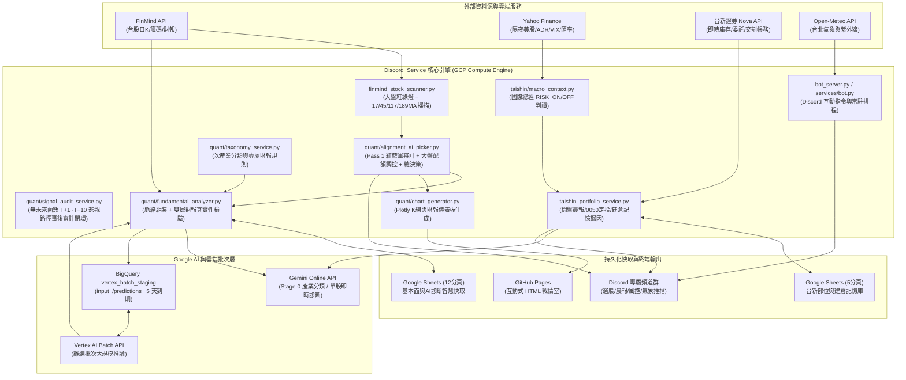
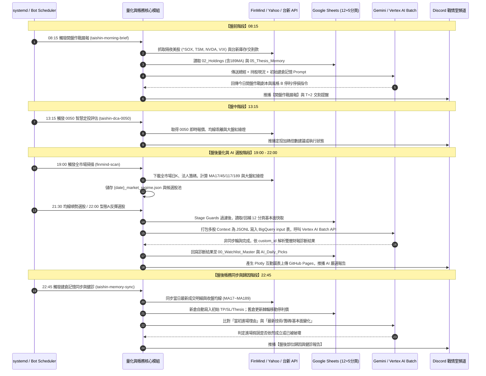
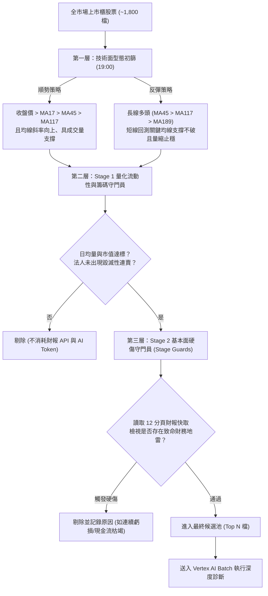

# Discord_Service 系統分析與設計規格書 (SASD)

* **專案名稱**：Discord_Service — 台股量化分析、AI 雙層診斷與台新證券智慧作戰系統
* **版本**：v6.0.0 (Single Source of Truth)
* **最後更新日期**：2026-11-16
* **運行環境**：Google Cloud Platform (GCP Compute Engine) + Linux `systemd` + Python 3.11 (`uv`)

---

## 目錄 (Table of Contents)

1. [第一章：需求分析 (Requirements Analysis)](#第一章需求分析-requirements-analysis)
   * 1.1 專案背景與核心痛點
   * 1.2 功能性需求 (Functional Requirements)
   * 1.3 非功能性需求 (Non-Functional Requirements)
2. [第二章：系統解決方案與整體架構 (System Architecture & Solutions)](#第二章系統解決方案與整體架構-system-architecture--solutions)
   * 2.1 痛點與技術解決方案對照表
   * 2.2 系統高階模組架構圖
   * 2.3 雲端與本地資料儲存設計 (12+5 分頁架構)
   * 2.4 全日自動化排程與時序圖
3. [第三章：核心業務流程設計 (Core Business Workflows)](#第三章核心業務流程設計-core-business-workflows)
   * 3.1 盤後量化掃描與兩階段 Pre-filter 漏斗流程
   * 3.2 Vertex AI Batch 離線批次與雙層基本面診斷流程
   * 3.3 建倉記憶錨定與「風格 B」棘輪移動停利流程
4. [第四章：AI 賦能盤點與 Prompt 資訊供給規格 (AI Context Inventory)](#第四章ai-賦能盤點與-prompt-資訊供給規格-ai-context-inventory)
   * 4.1 任務一：Stage 1 外部法說指引與輿情事實查核
   * 4.2 任務二：Stage 2 個股深度基本面與技術面綜合診斷
   * 4.3 任務三：08:15 開盤作戰晨報 AI 劇本生成
   * 4.4 任務四：22:45 建倉記憶歸因與盤後持股健診
   * 4.5 ★ AI 資訊供給充足度評估與未來擴充建議表
5. [第五章：系統效益分析 (Benefits Analysis)](#第五章系統效益分析-benefits-analysis)
   * 5.1 API 與 AI 運算成本效益
   * 5.2 交易紀律與風險控制效益
   * 5.3 投研時間與系統維運效益
6. [第六章：架構決策與版本演進紀錄 (ADR & Release History)](#第六章架構決策與版本演進紀錄-adr--release-history)

---

## 第一章：需求分析 (Requirements Analysis)

### 1.1 專案背景與核心痛點

個人投資者在台股波段操作與資產管理中，普遍面臨以下五大結構性痛點：

1. **資訊高度碎片化與時間成本過高**：每日盤後需跨越技術線圖、三大法人籌碼、月營收、季財報（損益表、資產負債表、現金流量表）以及隔夜美股總經數據進行交叉比對，人工檢視超過 1,800 檔上市櫃股票耗時且易有盲點。
2. **公司法說指引與實際財報落差（吹噓陷阱）**：許多題材股對外釋出樂觀指引，但實際財報卻出現「自由現金流為負」、「應收帳款與存貨週轉天數暴增」或「毛利率未如期提升」等警訊，單靠技術面極易買在主力出貨高點。
3. **進場後的主觀情緒干擾與「交易失憶症」**：買進時設定好停損與停利計畫，但盤中受價格波動影響而出現「賺一點就跑」或「跌破支撐卻凹單成長期股東」，忘記當初買進的核心假說（Thesis）。
4. **長短天期趨勢保護不足**：僅看短中期均線（如 17MA、45MA、117MA）容易在大型景氣循環轉折或長線走空時誤判支撐，缺乏長天期年線級別（189MA）的多空分水嶺保護。
5. **AI 即時推論成本高昂與連線逾時風險**：盤後對數十檔候選標的同時發起 LLM 即時請求（Online API），容易觸發 Rate Limit（429 錯誤）、等待時間過長，且 Token 費用居高不下。

---

### 1.2 功能性需求 (Functional Requirements)

| 需求編號 | 模組領域 | 需求描述 |
| :--- | :--- | :--- |
| **FR-01** | **大盤環境判讀** | 每日自動計算加權指數（TAIEX）之 17MA、45MA、117MA、189MA、騰落指標與外資期貨未平倉，判定大盤紅綠燈狀態（`GREEN` / `YELLOW` / `RED`）。 |
| **FR-02** | **量化雙策略選股** | 支援「均線多頭順勢排列（Alignment）」與「型態 A 跌深支撐反彈（Rebound）」兩種量化策略，並針對產業特性與流動性進行前置過濾（Pre-filter）。 |
| **FR-03** | **雙層 AI 財報診斷** | 結合產業分類規則（Sub-sector Taxonomy）與 Google Sheets 12 分頁財報快取，對候選股執行「真實性檢驗（Reality Check）」，並支援單筆即時與 Vertex AI Batch 離線批次雙模式。 |
| **FR-04** | **互動式圖表戰情室** | 自動產出包含 K 線、四條核心均線（17/45/117/189MA）、成交量、法人買賣超與財報儀表板的 Plotly 互動網頁，並自動發布至 GitHub Pages。 |
| **FR-05** | **台新證券帳務與交割連動** | 串接台新證券 Nova API，同步庫存成本、歷史已實現損益、計算 $T+2$ 交割款需求，並提供 0050 智慧不定期定額評估。 |
| **FR-06** | **建倉記憶與紀律風控** | 自動記錄每筆買進部位的「初始目標價（TP1/TP2）、初始停損價（SL）與進場理由」，每日 08:15 結合隔夜美股生成開盤作戰晨報，並於 22:45 執行盤後歸因健診。 |

---

### 1.3 非功能性需求 (Non-Functional Requirements)

* **NFR-01 成本最佳化**：盤後批次選股必須支援 GCP Vertex AI Batch API（享標準定價 50% 折扣），並透過本地與雲端多級快取減少重複呼叫。
* **NFR-02 容錯與高可用性**：當外部 API（FinMind、Google Sheets、Vertex AI、台新 API）發生瞬斷時，需具備指數退避重試（Exponential Backoff）與降級（Fallback）機制。
* **NFR-03 結構化輸出保證**：所有 AI 診斷結果必須通過嚴格的 JSON Schema 驗證與正規表達式修復，確保後續數值計算與表單寫入不中斷。
* **NFR-04 可觀測性與稽核**：所有 AI 請求與回應（含 Prompt 長度、Token 消耗、模型名稱、耗時）必須完整寫入本地 `finmind_reports/logs/YYYY-MM-DD_ai_calls.log` 並歸檔至 BigQuery `discord_service.ai_prompt_logs`。

---

## 第二章：系統解決方案與整體架構 (System Architecture & Solutions)

### 2.1 痛點與技術解決方案對照表

| 核心痛點 | 系統設計解決方案 | 對應核心模組 |
| :--- | :--- | :--- |
| **資料抓取緩慢與配額限制** | 建立 **Google Sheets 12 分頁智慧快取架構**，區分季報、月營收與日籌碼之 TTL（存活時間），搭配本地 JSON 快取。 | `quant/fundamental_cache.py` |
| **產業標準不一（拿電子股標準審金融/營建）** | 建立 **Sub-sector Taxonomy 產業專屬評估引擎**，針對半導體、AI 伺服器、航運、金融、生技、營建等定義專屬關鍵指標與地雷條件。 | `quant/taxonomy_service.py`<br>`quant/fundamental_config.py` |
| **無效標的浪費 AI Token** | 設計 **兩階段量化守門員（Stage Guards）**，先剔除日均量不足、淨值比異常或財務硬傷標的，僅放行高勝率候選股進入 AI 診斷。 | `finmind_stock_scanner.py`<br>`quant/alignment_ai_picker.py` |
| **批次選股 API 逾時與高成本** | 將診斷流程拆解為 `prepare_diagnosis_context()` 與 `finalize_diagnosis_from_ai()`，導入 **Vertex AI Batch API + BigQuery（input_/predictions_ 暫存表）** 離線非同步推論。 | `services/ai_service.py`<br>`quant/fundamental_analyzer.py` |
| **散戶凹單與停利過早** | 設計 **05_Position_Thesis_Memory 建倉記憶庫**，強制錨定初始 TP/SL，並實作 **風格 B（觸及 TP1 賣一半 + 單向棘輪移動停利）**。 | `taishin_portfolio_service.py`<br>`taishin/taishin_config.py` |
| **缺乏長線保護與國際視野** | 全面納入 **189MA（長線多空線）** 監控，並於盤前自動抓取費半、TSM ADR、NVDA、VIX、匯率計算 **Macro Regime**。 | `taishin/macro_context.py`<br>`finmind_stock_scanner.py` |

---

### 2.2 系統高階模組架構圖



---

### 2.3 雲端與本地資料儲存設計 (12+5 分頁架構)

系統採用雙 Google Spreadsheets 作為輕量級雲端關聯式資料庫與視覺化後台，結構如下：

#### A. 基本面智慧快取表 (`Fundamental_Cache`，共 12 張核心分頁 + 1 張事後審計輔助分頁)
定義於 `quant/fundamental_config.py` 之 `SHEET_SCHEMAS`：
1. `00_Watchlist_Master`：主控索引與 AI 快取表（記錄股名、產業、各表最新資料水位 `last_rev_ym` / `last_fin_qtr` / `max_div_raw_date` / `max_chip_raw_date`、探測冷卻時間 `last_probe_at`、Stage 1 結構化診斷快取 `ai_summary_json`、`ai_model_version` 與 `war_room_url`）。
2. `01_Monthly_Revenue`：月營收動能表（單月營收、`mom_pct`、`yoy_pct`）。
3. `02_Income_Statement`：季度綜合損益表（單季營收、營業成本、毛利、營業費用、營業利益、業外收支、稅前/稅後淨利、母公司淨利、EPS）。
4. `03_Balance_Sheet`：季度資產負債表（現金、金融資產、應收帳款、存貨、PPE、短長期借款、合約負債、應付帳款、實收股本 `capital_stock`、保留盈餘、母公司權益與總權益）。
5. `04_Cash_Flow`：單季現金流量表（自動將 FinMind Q2/Q3/Q4 累季值拆解為單季真實流量，含折舊攤銷、AR/存貨/AP 營運資金變動、營業現金流 OCF、資本支出 CapEx、自由現金流 FCF）。
6. `05_AI_Metrics_Wide`：AI 衍生財務比率寬表（後端 Pandas 精確算妥之毛利率、費用率、營益率、業外佔比、母公司淨利率、單季與 TTM EPS、年化 ROE、DIO/DSO/DPO/CCC 週轉天數、合約負債、OCF/CapEx/FCF、OCF/NI 含金量、EBITDA、有息負債、淨負債比、流動/速動比、利息保障倍數與單季營收 YoY）。
7. `06_Dividend_Policy`：歷年股利政策表（西元股利年度、現金股利、股票股利、總股利、現金股利總額、年度 EPS、配息率 `payout_ratio_pct`、除息日與發放日）。
8. `07_Chip_Summary`：三大法人籌碼、個股信用交易與 TDCC 集保大戶快取表（外資持股比例與 20 日變化、外資/投信/自營商及三大法人近 5 日與 20 日買賣超張數、`margin_balance_lots`、`margin_utilization_pct`、`margin_chg_5d_lots`、`margin_chg_20d_lots`、`short_margin_ratio_pct`、`est_margin_maint_pct` 估算融資維持率、`chip_quadrant_tag` 資法人對作四象限標籤；v5.9.4 新增 TDCC 官方免費 Open Data 集保欄位：`tdcc_date`、`tdcc_400_lots_pct`、`tdcc_1000_lots_pct`、`tdcc_1000_lots_diff_pct`、`tdcc_total_shareholders`）。
9. `08_Stock_Taxonomy`：細分次產業分類知識庫與同業標籤快取（`official_industry`、`sector_group`、`sub_industry`、`valuation_regime`、`component_nature`、`supply_chain_role`、`core_products`、`theme_tags`、`peers`，同步本地快取 `finmind_reports/.state/stock_taxonomy.json`）。
10. `MA_Signal_Tracker`：19:00 均線與量能強勢股追蹤表（記錄每日符合五線排列之個股、新進/連榜天數、17MA 走勢、量能狀態與五條均線數值）。
11. `AI_Daily_Picks`：21:30 AI 嚴選進場歷史追蹤表（記錄每日 `TOP_PICK` / `WATCHLIST` / `AVOID`、推薦當下收盤與均線、財報分、總決策分、法說展望評級、進退場點位與 9 個確定性紅藍軍審計欄位）。
12. `Rebound_Watchlist`：22:00 型態 A 長均線回踩反彈清單（記錄 60 日高點跌幅、回踩支撐均線、17MA 反彈目標潛在空間與 AI 診斷結果）。
* **事後審計輔助分頁 (`Signal_Audit_Log`)**：由 `quant/signal_audit_service.py` 獨立維護本地 SQLite `data/signal_audit.db`，並於 19:00 / 21:30 / `audit-signals` 執行時將無未來函數事後追蹤紀錄（T+1 實質進場價、T+5/T+10 淨報酬、MFE/MAE、洗盤標記與 `REJECT_TRAP` 錯殺標記）同步至同一試算表之 `Signal_Audit_Log` 分頁。

#### B. 台新個人投資作戰中心 (`Taishin_Portfolio`，共 5 分頁)
定義於 `taishin/taishin_config.py` 之 `TAISHIN_SHEET_SCHEMAS`：
1. `01_Account_Statement`：全歷史買賣交易對帳單與成交總表。
2. `02_Portfolio_Holdings`：即時庫存明細，包含成本均價、市價、損益率，以及技術面五均線 **`ma3`、`ma17`、`ma45`、`ma117`、`ma189`** 與開盤 AI 建議。
3. `03_Settlement_And_PnL`：歷史交割與已實現損益紀錄。
4. `04_DCA_0050_Tracker`：0050 每週不定期定額智慧尋底追蹤表。
5. `05_Position_Thesis_Memory`：**AI 建倉記憶核心表**，鎖定 `initial_tp1`、`initial_tp2`、`initial_sl`、`trailing_stop`、`entry_thesis`、`invalidation_rule` 及 9 個確定性紅藍軍審計欄位。

---

### 2.4 全日自動化排程與時序圖 (Single Source of Truth)

> 📌 **開發鐵則**：以下排程時間僅由作業系統層級之 `systemd` timers 控制，**嚴禁在 Python 業務邏輯、函式預設參數、Prompt 模板或 Discord 訊息標題中寫死時間字串**。所有報表標題與程式碼邏輯一律改為「功能導向描述」。

| 排程時間 (CST) | Systemd Timer / Service | 執行入口與核心職責 | 標準化 Discord 報表標題（無時間前綴） |
| :--- | :--- | :--- | :--- |
| **08:15** | `taishin-morning-brief.timer` | 盤前隔夜美股與波段持股開盤作戰指令 (`taishin_portfolio_service.py morning-brief`) | `☀️ 【台新證券 盤前開盤作戰晨報】` |
| **13:15** | `taishin-dca-0050.timer` | 0050 每週智慧尋底定投評估 (`taishin_portfolio_service.py eval-dca-0050`) | `📈 【0050 每週智慧尋底定投評估】` |
| **19:00** | `finmind-scan.timer` | 全市場日K、均線、大盤紅綠燈與融資水位掃描 (`finmind_stock_scanner.py`) | `📊 【台股盤後量化掃描快報】` |
| **21:30** | `finmind-ai-pick.timer` | 均線多頭順勢選股與 Stage 2 跨股總決策 (`alignment_ai_picker.py` trend mode) | `🎯 【AI 嚴選進場決策報告】` |
| **22:00** | `finmind-rebound-ai.timer` | 型態 A 急跌回踩長均線反彈選股 (`alignment_ai_picker.py` rebound mode) | `🎯 【型態 A 反彈 AI 嚴選決策報告】` |
| **22:45** | `taishin-memory-sync.timer` | 盤後對帳單同步與建倉記憶歸因 (`taishin_portfolio_service.py sync-memory`) | `🌙 【台新 盤後持股記憶歸因快訊】` |



---

## 第三章：核心業務流程設計 (Core Business Workflows)

### 3.1 盤後量化掃描與兩階段 Pre-filter 漏斗流程

為了避免將全市場 1,800 檔股票直接送入 AI 造成巨額費用與雜訊，系統設計了嚴格的漏斗篩選機制：



---

### 3.2 Vertex AI Batch 離線批次與雙層基本面診斷流程 (v5.3.0 核心)

在 `quant/fundamental_analyzer.py` 與 `services/ai_service.py` 中，單筆即時模式（Discord `/stock_ai` 指令）與排程批次模式（21:30 / 22:00）共用相同的商業邏輯，透過「前後端解耦」實現：

1. **脈絡準備階段 (`prepare_diagnosis_context`)**：
   * 確認個股次產業分類（`08_Stock_Taxonomy`），載入估值屬性（`valuation_regime`）與產業專屬的觀察指標（例如：金融業不看毛利率與自由現金流；營建業重看合約負債與完工入帳週期）。
   * 自動抓取 Yahoo 股市個股 RSS（近 30 天重訊與報導）與 Google News 機構級財經媒體白名單檢索（近 180 天法說會展望），過濾農場文與空殼標題。
   * 組裝完整的基本面（表 1~5）、股利與法人融資籌碼（表 6）、五線均線與量價（表 7），生成標準化的 Stage 1 單股診斷 Prompt（`STAGE1_DIAGNOSIS`）與唯一識別碼 `custom_id`（格式如 `diag_{date}_{stock_id}`）。
2. **批次提交與輪詢階段 (`run_vertex_batch_requests`)**：
   * **端點分流設計**：AI 模型推論端點（Vertex AI API / Batch）一律固定使用 `VERTEX_LOCATION="global"`（避免 `gemini-4-argon`、`gemini-3.8-flash` 等新世代模型在區域端點發生 `404 NOT_FOUND`）；BigQuery 暫存與永久表則存放在 `BQ_LOCATION="us-central1"`。
   * 將所有候選股的請求寫入專屬 BigQuery 輸入表（`bq://{project}.vertex_batch_staging.input_{seq}`，5 天自動到期）。
   * 呼叫 Vertex AI Batch Prediction Job 提交任務，系統以非同步輪詢（Polling）監控任務狀態，完成後讀取 BigQuery `predictions_{seq}` 輸出表，並以免費 Batch Load 歸檔至 `discord_service.ai_prompt_logs`。
3. **結果回填與快取階段 (`finalize_diagnosis_from_ai`)**：
   * 依據 `custom_id` 將 AI 回傳的 `===SUMMARY_JSON===` 解析並經過 `sanitize_stage1_json()` 防呆校驗（例如：無實質內文時強制將 `guidance.verdict` 標記為 `"無資料"`）。
   * 寫入 `00_Watchlist_Master`（`ai_summary_json`）與本地 `finmind_reports/logs/YYYY-MM-DD_ai_calls.log`。

---

### 3.3 建倉記憶錨定與「風格 B」棘輪移動停利流程

系統透過 `05_Position_Thesis_Memory` 解決散戶「忘記初衷」與「抱上抱下」的問題：

* **初始建倉錨定**：當 `taishin-memory-sync` 偵測到新買進庫存時，會自動調閱最近一次 AI 選股報告或即時觸發診斷，將買進當下的：
  * 初始第一目標價 $TP_1$
  * 初始第二目標價 $TP_2$
  * 初始防守停損價 $SL_{init}$
  * 進場核心理由（`entry_thesis`）
  寫入記憶庫並鎖定（不可隨每日股價波動而任意下修停損）。
* **風格 B（分批鎖利 + 單向棘輪防守）運算邏輯**：
  * **階段一（未達 $TP_1$）**：防守線為 $\max(SL_{init}, \text{關鍵防守均線})$。若收盤跌破 $SL_{init}$，觸發無條件停損警報。
  * **階段二（觸及或突破 $TP_1$）**：
    1. 系統將 `tp1_hit_flag` 設為 `True`，於 08:15 晨報強制提示：**「執行風格 B：建議先調節 50% 部位（可掛盤中零股）鎖定獲利」**。
    2. 剩餘 50% 部位啟動 **單向棘輪移動停利（Ratchet Trailing Stop）**，新防守價計算公式為：
       $$SL_{new} = \max\left(SL_{prev}, \text{Cost}_{avg}, MA_{17}, MA_{45}\right)$$
       防守價**只升不降**（$SL_t \ge SL_{t-1}$），確保波段獲利不會回吐變成虧損，並一路追蹤至 $TP_2$ 或跌破移動停利線為止。

### 3.4 SASD v6.1 三階段專職分工：跨股績優股選拔 (AI #2) ➔ 戰略回檔低接與雙層籌碼分配 (AI #3)

為解決將「選股（公司體質好壞）」與「擇時（今天現價能不能買）」混為一談、導致優質好股因短線 17MA 下彎或大盤紅燈被誤殺，或推薦現價追高買在短線高點的結構性問題，SASD v6.1 將盤後選股重構為三階段 Vertex AI Batch 專職分工架構：

```
[AI #1: STAGE1_DIAGNOSIS] (gemini-3.8-flash, Batch + 00_Watchlist_Master 快取)
   └─ 單股近 8 季四大報表、12 個月營收、法說展望與籌碼深潛（移除 17MA 下彎對體質之扣分）
   ↓
[AI #2: QUALITY_SELECT] (gemini-4-argon, Batch 單一跨股請求: AI_PICK_QUALITY_SELECT / REBOUND_QUALITY_SELECT)
   ├─ 純審視基本面硬實力 (45%) + 法說未來性與話題催化劑 (35%) + 法人與集保大戶底氣 (20%)
   ├─ 選股與擇時徹底解耦：豁免大盤紅燈、短線正乖離與 17MA 下彎；21:30 驗證業績成長真實性、22:00 進行急跌賣壓錯殺歸因
   └─ 剔除殺價搶單/利多出貨地雷，精選出 Top 3~5 檔「就算短線被套牢未來回漲創高機率也極高」之真績優股
   ↓
[Python 戰略武器庫組裝] (僅針對入選之 Top 3~5 檔績優股)
   ├─ build_strategic_tech_and_chip_package()：
   │   1. 近 20 交易日「K線(OHLC+影線) + 成交量 + 五線歷史均線(MA3~189) + KD(9)/RSI(14)/MACD + 三大法人逐日買賣超 + 個股融資逐日增減」對齊大表
   │   2. 三大大量支撐定位器（60日分價量 POC/VAH/VAL 與現價下方最大量支撐區 Lower Support POC #1/#2、近60日爆量紅K/長下影承接防守低點、投信/外資 20d/60d 買超加權成本均價 VWAP）
   │   3. 近 60/120 日波段高低點、黃金分割回檔位 (0.236~0.786)、未回補跳空缺口、五線均線斜率與未來 5 日扣抵價、基本面價值鐵底價
   ├─ build_market_daily_trend_block()：台股大盤基準近 10 交易日價量、五線均線、KD/RSI/MACD 與大盤整體融資餘額/增減趨勢
   ├─ fetch_global_macro_context()：隔夜美股七大指標（費半 ^SOX、那指 ^IXIC、標普 ^GSPC、TSM ADR、NVDA、^VIX 恐慌指數、TWD=X 匯率）
   └─ evaluate_candidate_exposure()：台新現有持股同產業與 60 日報酬相關係數曝險檢核
   ↓
[AI #3: STRATEGIC_LAYOUT] (gemini-4-argon, Batch 單一跨股請求: AI_PICK_STRATEGIC_LAYOUT / REBOUND_STRATEGIC_LAYOUT)
   ├─ 21:30 順勢版 (`strategic_layout_trend`) vs 22:00 反彈版 (`strategic_layout_rebound`，17MA 為上方 TP1 反壓) 專屬戰術分流
   ├─ 第一層（總體倉位與各股權重）：輸出 `recommended_total_exposure_pct`（建議總持倉水位 %）與各股 `Allocation_Weight_Pct`（資金權重 %，總和 100%）
   └─ 第二層（三階金字塔回檔低接掛單，嚴禁現價追高）：輸出 `Tier1_Entry_Plan` (第1批30%試單)、`Tier2_Entry_Plan` (第2批40%核心)、`Tier3_Entry_Plan` (第3批30%黃金坑)、預估加權均價、追價上限、波段 TP1/TP2 與硬停損
```

* **輸出與下游銜接**：`AI_Daily_Picks` 與 `Rebound_Watchlist` 同步擴充 `Allocation_Weight_Pct`、`Tier1_Entry_Plan`、`Tier2_Entry_Plan`、`Tier3_Entry_Plan` 四欄（由 `ensure_workbook_schema()` 自動於試算表尾端新增），並同步填入 `Ideal_Buy_Or_Ref`、`Chase_Limit_Price`、`Hard_Stop_Loss`、`TP1_Target_Or_POC` 供 22:45 `sync-memory` 與隔日 08:15 開盤晨報無縫繼承。

---

## 第四章：AI 賦能盤點與 Prompt 資訊供給規格 (AI Context Inventory)

本章節完整盤點系統在核心 AI 任務中**實際餵給模型的每一項數據欄位**，與程式碼實作 100% 對齊。

---

### 4.1 任務一：Stage 0 細分產業分類與同業定錨 (`TAXONOMY`)

* **觸發時機**：個股首次進入候選池或 `/stock_ai` 查詢，且 `08_Stock_Taxonomy`（TTL 90 天）尚未快取時。
* **使用模型與資料源**：`AI_MODEL_BASE`（`gemini-flash-lite-latest`）+ Yahoo 股市公司業務簡介（`_extract_yahoo_business_summary()`，自動過濾 SEO 樣板字）。
* **餵給 AI 的資訊 (Inputs)**：
  * 股票代號 (`stock_id`)、股票名稱 (`stock_name`)、證交所/FinMind 官方大類 (`official_industry`)、Yahoo 股市實質業務與產品描述。
* **要求 AI 產出的結構化欄位 (`08_Stock_Taxonomy`)**：
  1. `sector_group`（互斥六大板塊）、`sub_industry`（細分次產業，供 Stage 2 同業限額與廣度計算）。
  2. `valuation_regime`（`景氣循環股` / `穩健價值與高息股` / `成長型科技與利基股` / `高本益比/題材研發股`）。
  3. `component_nature`、`supply_chain_role`、`core_products`、`theme_tags`、`peers`（經 Python 真實代號防幻覺校驗）。

---

### 4.2 任務二：AI #1 單股診斷 (`STAGE1_DIAGNOSIS`) ➔ AI #2 跨股績優股選拔 (`QUALITY_SELECT`) ➔ AI #3 戰略回檔低接與雙層籌碼分配 (`STRATEGIC_LAYOUT`)

* **觸發時機與 `task_type` 識別碼**：21:30 順勢選股寫入 `AI_PICK_*`（`AI_PICK_TAXONOMY` / `AI_PICK_STAGE1_DIAGNOSIS` / `AI_PICK_QUALITY_SELECT` / `AI_PICK_STRATEGIC_LAYOUT`），22:00 反彈選股寫入 `REBOUND_*`（`REBOUND_TAXONOMY` / `REBOUND_STAGE1_DIAGNOSIS` / `REBOUND_QUALITY_SELECT` / `REBOUND_STRATEGIC_LAYOUT`），Discord `/stock_ai` 即時指令寫入 `STOCK_AI_CMD_DIAGNOSIS` / `STOCK_AI_CMD_QUERY` / `STOCK_AI_CMD_COMPARE` / `STOCK_AI_CMD_TAXONOMY`。
* **餵給 AI 的完整資料清單 (Context Payload)**：

| 資訊維度 | 餵入 AI Prompt 的具體數據欄位與計算邏輯 | 資料時間跨度 |
| :--- | :--- | :--- |
| **1. Stage 0 產業定錨與預計算錨點** | • `sector_group`、`sub_industry`、`valuation_regime`、直接同業清單<br/>• Python 預先算妥之 `PE`、`PB`、`近一年現金殖利率`、`17MA 乖離率`、`17MA+12% 極值價`、`收盤 -4% 停損價` | 靜態規則庫 + 最新日資料 |
| **2. 即時重訊與法說展望 RSS** | • Yahoo 股市個股 RSS（近 30 天重訊與新聞摘要）<br/>• Google News 機構級財經媒體白名單檢索（近 180 天法說會展望，空殼標題強制標註零腦補警示） | 近 30 ~ 180 天公開資訊 |
| **3. 獲利能力 (表 1 損益結構)** | • 單季營收（億元）、毛利率、營業費用率、營益率、業外佔稅前淨利比 (`non_op_share_pct`)、母公司淨利率<br/>• 單季 EPS、近四季累積 $EPS_{TTM}$ 與單季營收 YoY | 近 8 季趨勢 |
| **4. 營收動能 (表 5 月營收)** | • 單月營收（億元）、月增率 ($\text{MoM } \%$)、年增率 ($\text{YoY } \%$)<br/>• Phase 2 擴充：含春節豁免之加權 3M YoY 與本季達成率 (`QTD Run-Rate`) | 近 12 個月 |
| **5. 領先指標與營運效率 (表 2)** | • **現金轉換週期 ($CCC$)**：$$\text{CCC} = \text{DSO (應收天數)} + \text{DIO (存貨天數)} - \text{DPO (應付天數)}$$<br/>• **合約負債 (`contract_liab_亿元`)**：預收貨款/在手訂單領先指標 | 近 8 季比較 |
| **6. 現金流品質 (表 3)** | • 單季營業現金流 ($OCF$)、資本支出 ($CapEx$)、自由現金流 ($FCF$)、折舊攤銷、AR/存貨/AP 營運資金變動<br/>• **盈餘品質比率**：$\text{OCF} / \text{NI}$（%） | 近 8 季 |
| **7. 償債與財務結構 (表 4)** | • 有息負債總額、淨負債比率 (`net_debt_ratio_pct`)、流動比率、速動比率、利息保障倍數、年化 ROE、EBITDA | 近 8 季 |
| **8. 股利與法人/信用籌碼 (表 6)** | • 近 5 年現金/股票股利、配息率 (`payout_ratio_pct`)<br/>• 外資持股比與 20 日變化、外資/投信/自營商/三大法人近 5 日與 20 日買賣超（張）<br/>• 融資餘額、融資使用率、5D/20D 融資增減、券資比、估算融資維持率 (`est_margin_maint_pct`)、`chip_quadrant_tag` | 近 5 年配息 + 最新週/日籌碼 |
| **9. 技術位階與微結構 (表 7 & Pass 1)** | • 收盤價、今日量/5日均量/20日均量、量比狀態<br/>• **五條均線**：$\text{MA}_{3}, \text{MA}_{17}, \text{MA}_{45}, \text{MA}_{117}, \text{MA}_{189}$、17MA 近 5 日斜率与乖離率<br/>• **Pass 1 微結構與確定性點位**：大盤雙指數配額 (`RegimeQuota`)、處置過熱雷達、同族群 17MA 廣度、`ATR14`、`60 日量 POC`、追價上限、硬停損、`TP1`、`deterministic_rr_ratio`、台新庫存相關係數曝險與近 3 則新聞量價反應 | 近 5 ~ 60 交易日 |

* **Stage 1 (`STAGE1_DIAGNOSIS`) 產出之 `===SUMMARY_JSON===` 欄位**：
  * `verdict`（一句話核心結論）、`score`（$0 \sim 100$ 整數）、`trend_tags`（`margin_trend` / `rev_momentum` / `fcf_nature`）。
  * `highlights`（1~4 點含期別數據）、`risks`（1~4 點含硬傷與期別數據）、`fcf_and_roe`、`chip_and_dividend`。
  * `guidance`：`claims`、`reality_check`、`verdict`（僅限 `"高度可信"` | `"待驗證"` | `"存疑"` | `"無資料"` 四選一）。
  * `technical_view`、`trade_plan`（`tactical_type`, `entry_trigger`, `target_price_1`, `target_price_2`, `stop_loss_price`, `invalidation`）。
* **Pass 1 (`RED_BLUE_AUDIT`) 與 Stage 2 (`STAGE2_PORTFOLIO`) 銜接產出**：
  * Pass 1 依序生成 `bear_case_flaws` ➔ `bull_case_catalysts` ➔ `conflict_resolution_reasoning` ➔ `execution_strategy_type` ➔ `thesis_invalidation_triggers` ➔ `verdict_grade`（`S_TIER_SNIPER` / `A_TIER_PULLBACK` / `REJECT_TRAP`）。
  * Stage 2 綜合 `[A]` 均線量能、`[B]` 量化財務、`[C]` Stage 1 結論與 `[D]` 紅藍軍點位，輸出 `market_light`、`market_comment`、`top_picks`、`watchlist`、`avoid`。

---

### 4.3 任務三：08:15 開盤作戰晨報 AI 劇本生成

* **觸發時機**：每週一至週五 08:15 (`taishin-morning-brief`)。
* **餵給 AI 的完整資料清單 (Context Payload)**：
  1. **隔夜國際總經數據 (`macro_context.py`)**：
     * 費城半導體指數 (`^SOX`)、那斯達克 (`^IXIC`)、標普 500 (`^GSPC`) 漲跌幅。
     * 台積電 ADR (`TSM`)、輝達 (`NVDA`) 漲跌幅。
     * 恐慌指數 (`^VIX`) 水位與變化、美元兌台幣匯率 (`TWD=X`)。
     * 系統量化判定之總經環境標籤：`RISK_ON`（積極偏多）、`NEUTRAL`（震盪分歧）、`RISK_OFF`（避險防守）。
  2. **台股大盤紅綠燈快取**：
     * 加權指數收盤價與 $\text{MA}_{17}, \text{MA}_{45}, \text{MA}_{117}, \text{MA}_{189}$ 相對位階。
  3. **帳戶資金與交割狀態**：
     * 今日與明日 ($T+1, T+2$) 應收付交割款淨額、帳戶可用現金水位。
  4. **個別持股部位與建倉記憶對照**：
     * 每檔庫存股之：代號、名稱、持有股數、成本均價、最新市價、未實現損益金額與百分比、佔總持倉權重 (`weight_pct`)。
     * 技術微結構與支撐位：該股最新 $\text{MA}_{17}, \text{MA}_{45}, \text{MA}_{117}, \text{MA}_{189}$、17MA/189MA 乖離率、`RSI(14)`、昨高/昨低、`ATR(14)`、60 日大量 POC、當日漲跌幅同業百分位 `daily_return_pr`、同細分產業 17MA 資金廣度 (`sector_breadth_pct`)、處置過熱預警 (`disposition_tag`)，以及右側棘輪防守參考 (`ratchet_stop_floor`)、左側結構支撐參考 (`left_side_structural_floor`) 與反彈第一反壓參考 (`rebound_resistance_target`)。
     * 深度基本面與籌碼微結構（由 `FundamentalCacheManager` + `FundamentalAnalyzer` 整合）：最新季報 EPS / 三率、`存貨 / 合約負債 / DIO / DSO`、單季 OCF / FCF、月營收 YoY/MoM、Phase 2 本業前瞻估值（`Implied Core Forward EPS` / `Sector PE Ratio` / `QTD Run-Rate` / 三率趨勢語意）、近 5 日外資/投信/融資與估算融資維持率、週集保 400/1000 張大戶底氣 (`tdcc_summary`)、日融資 K 棒效率 (`daily_margin_eff_tag`)、強制回補日曆與近 3 則個股新聞量價反應 (`recent_news`)。
     * 記憶庫錨定值：`initial_tp1`、`initial_tp2`、`initial_sl`、目前移動停利價 `trailing_stop`、`status`、當初買進理由 `entry_thesis`、失效紅線 `invalidation_rule`，以及建倉時紅藍軍審計備忘（`Audit_Grade`、`Execution_Tactic`、`Deterministic_RR`、`Bear_Case_Warning`、`Invalidation_Triggers`）。
  5. **昨晚最新《AI 嚴選強勢潛力新星》（`fresh_top_picks_block` 雙池整合）**：
     * 同時彙整最新掃描日順勢 `AI_Daily_Picks` (`TOP_PICK`) 與型態 A 回踩長均線反彈 `Rebound_Watchlist`，作為破線股執行 `🔄 趁彈減碼換股` 汰弱留強之機會成本對照；大盤紅燈雙核心路由 (`RegimeRouter.fetch_live_dual_regime`) 亦自動補齊加權與櫃買 OTC 雙指數視野。
* **要求 AI 產出的內容（智慧雙軌決策引擎）**：
  * 今日台股開盤跳空方向預判與資金控管總綱。
  * 逐檔持股之今日盤中具體操作指令與雙軌停損定錨：右側順勢嚴守 `ratchet_stop_floor`（達 TP1 執行風格 B 賣半鎖利）；跌破防線時透過四維度穿透審判區分「`🎯 逢低加碼` / `🛡️ 破線轉價值防守`（`thesis_intact=true` 可重定錨至左側結構防線）」與「`🔄 趁彈減碼換股` / `🚨 觸及停損` / `⚠️ 邏輯失效減碼`」。

---

### 4.4 任務四：22:45 建倉記憶歸因與盤後持股健診

* **觸發時機**：每週一至週五 22:45 (`taishin-memory-sync`)。
* **餵給 AI 的完整資料清單 (Context Payload)**：
  * 持股當初建倉鎖定的 `entry_thesis`（例如：「看好 Q3 毛利率跳升與投信連買突破 45MA」）。
  * 今日最新收盤價與 $\text{MA}_{17}, \text{MA}_{45}, \text{MA}_{117}, \text{MA}_{189}$ 跌破/站穩狀態。
  * 最新三大法人買賣超變化、最新月營收與財報快取摘要。
* **要求 AI 產出的內容**：
  * **Thesis 存續性判定**：「進場理由強化」、「理由維持不變」或「進場理由已遭破壞（Thesis Broken）」。
  * 若進場理由已遭破壞（即使尚未觸及價格停損 $SL$），提前發出主觀歸因預警，防止基本面或籌碼面轉空卻死守技術停損位。
* **追蹤股公用快取自動保鮮**：
  * 於 `reconcile_position_memory(...)` 寫入 `05_Position_Thesis_Memory` 後，針對所有 `OPEN` / `TP1_PARTIAL_TAKEN` 追蹤股（非 `--dry-run` 時）呼叫 `FundamentalCacheManager.check_and_sync_stock(sno)` 自動同步最新季報、月營收與籌碼快取，確保隔日 08:15 `morning-brief` 取得最新實測數據；單檔失敗僅記錄警告，不影響排程完成。

---

### 4.5 ★ AI 資訊供給充足度評估與未來擴充建議表

為了協助您評估「目前餵給 AI 的資訊是否足夠」，以下針對各維度進行診斷：

| 評估維度 | 目前供給給 AI 的資訊量 | 充足度評級 | 潛在盲點分析與未來可擴充之高價值資訊 |
| :--- | :--- | :---: | :--- |
| **基本面三表與現金流** | 涵蓋毛利/營益率、EPS、ROE、合約負債、CCC、OCF/NI、FCF、淨負債比、月營收 YoY/MoM、Phase 2 本業前瞻 EPS 與同業中位數 PE 對齊。 | **⭐⭐⭐⭐⭐<br/>(極度充足)** | 目前財務比率與橫斷面同業 PE 比值已達機構法人級別。唯一可再微調的是加入 **「同次產業毛利率橫向百分位數」**，減少 AI 對單一數值高低的誤判。 |
| **技術面趨勢與支撐** | 涵蓋收盤價、量能倍數、3/17/45/117/189MA、17MA 斜率與乖離率、ATR14、近 60 日大量成交密集區（Volume POC）與確定性 TP1/停損點位。 | **⭐⭐⭐⭐⭐<br/>(v5.6.0 補齊)** | 五線均線骨架與 60 日 Volume POC 已完整實作。未來若要強化突破真偽判斷，可補充 **「盤中分時均價線 (VWAP) 收斂度」** 或 **「歷史前波頸線壓力位」**。 |
| **籌碼面結構** | 涵蓋外資/投信/自營商 5D & 20D 買賣超、外資持股比例、融資使用率與維持率、日融資 K 線效率。 | **⭐⭐⭐⭐☆<br/>(充足)** | ⚠️ **實盤限制揭露**：FinMind 之 `TaiwanStockHoldingSharesPer`（TDCC 週集保股權分散表）需付費 **Sponsor** 等級帳號始可下載；在免費 `register` 等級下呼叫會被拒絕並靜默略過（故不產生 `tdcc_holding_cache.json`）。若不升級 FinMind，可改串接 **TDCC 集保中心官方免費 Open Data CSV (`smart.tdcc.com.tw`)** 以零成本補齊千張大戶數據。 |
| **法說指引與新聞輿情** | 串接 Yahoo 股市個股 RSS（含 MOPS 重訊摘要）與 Google News 機構級財經媒體白名單檢索，並綁定新聞發布日量價反應標籤。 | **⭐⭐⭐⭐☆<br/>(v5.9.2 升級)** | 已排除農場文與股市爆料同學會貼文，並對僅有標題之新聞強制零腦補警示。未來若能串接 **MOPS 法說會簡報 PDF 摘要** 或 **FactSet/券商共識 EPS**，法說驗證覆蓋率會更高。 |
| **盤前晨報與帳務風控** | 涵蓋美股四大指數/TSM/NVDA/VIX/匯率、庫存均價、3~189MA、單一持股權重 (`weight_pct`)、同產業與 60 日報酬相關係數曝險、初始 TP/SL/Thesis 與棘輪防守價。 | **⭐⭐⭐⭐⭐<br/>(極度充足)** | 部位權重、同產業集中度與雙軌停損定錨已全面閉環。 |

---

## 第五章：系統效益分析 (Benefits Analysis)

### 5.1 API 與 AI 運算成本效益

1. **Vertex AI Batch API 節省 50% 推論費用**：
   * 每日 21:30 與 22:00 選股排程改由 BigQuery + Vertex AI Batch 執行，相較於即時 Online API，直接降低 $50\%$ 的 Token 計費成本，且完全消除盤後大量併發請求造成的 `429 Resource Exhausted` 錯誤。
2. **兩階段 Pre-filter 與 12 分頁快取攔截 75% 以上無效消耗**：
   * 全市場約 1,800 檔股票經技術面初篩與 `StageGuards` 基本面硬傷過濾後，每日僅約 $10 \sim 25$ 檔高價值標的進入 AI 深度診斷；加上季報與月營收採用 Google Sheets 分頁快取，FinMind API 每日呼叫次數控制在安全配額內。

### 5.2 交易紀律與風險控制效益

1. **消除「交易失憶症」與凹單行為**：
   * 透過 `05_Position_Thesis_Memory` 強制記錄買進當下的 $TP_1, TP_2, SL_{init}$ 與進場理由，每日 08:15 與 22:45 自動拿「當初的自己」對照「現在的盤勢」，杜絕盤中臨時改口凹單。
2. **「風格 B」機械化鎖利提高資金周轉率**：
   * 觸及 $TP_1$ 先調節 $50\%$ 部位落袋為安，剩餘部位以單向棘輪移動停利保護，兼顧「落袋現金流」與「捕捉大波段趨勢」的雙重優勢。
3. **189MA 長線多空防線**：
   * 在大盤紅綠燈與個股庫存全面納入 `189MA`，當大盤或個股跌破長線生命線時提供明確降檔警訊，避免在空頭初期過早接刀。

### 5.3 投研時間與系統維運效益

* **每日節省 2.5 小時人工研究時間**：原本需人工翻閱數十檔股票財報、計算三率與現金流、繪製均線圖與核對台新交割款的工作，全部壓縮為 Discord 頻道中可一鍵點開的 Plotly 互動圖表與精煉作戰摘要。
* **全自動無狀態恢復**：透過 `systemd` Timer 排程機制，即使 GCP VM 重啟或網路瞬斷，排程與快取皆能自動銜接。

---

## 第六章：架構決策與版本演進紀錄 (ADR & Release History)

> 💡 **文件治理說明**：本章節整合專案關鍵架構決策（Architecture Decision Records, ADR）與重大版本演進快照，可直接作為專案的歷史演進索引，取代傳統獨立且易瑣碎化的 `CHANGELOG.md`。

| 版本號 | 發布日期 | 核心架構決策與改版重點 (Key Changes & ADRs) | 影響模組 |
| :--- | :--- | :--- | :--- |
| **v6.2.2** | 2026-11-23 | **修復大盤融資時間軸錯位 1 日 Bug、21:30 過期快取補刷與 AI #3 戰略布局防呆升級**：<br/>1. `fetch_market_margin_snapshot()` 優先改打含全市場合計與明確交易日之 TWSE/TPEx RWD 端點，新增 `_parse_tw_api_date()` 嚴格以 API 實際交易日寫入 `market_margin_history.json`，加入上市櫃公告不同步對齊防呆與官方 `margin_chg_1d_yi`；`fetch_or_load_market_regime()` 於快取融資過期時自動補刷。<br/>2. 修正 `build_strategic_tech_and_chip_package()` 破線急殺股三階低接價倒掛（強制 `現價 >= t1 > t2 > t3 > 硬停損`）、明數印出本業前瞻 EPS、`build_market_daily_trend_block()` 補齊 OTC 摘要／防腦補聲明；`fetch_global_macro_context()` 支援 `post_market` 模式標註美東收盤日並防昨日美股重複計價；AI #3 Prompt 補齊破線防禦分流、庫存共伴曝險降權、`MA3~MA17` 與「外資與投信」（防腦補自營商）。<br/>3. 新增純本地 `compute_relative_strength_and_beta()`（5/20 日超額報酬 RS ＋ 60 日 Beta）、`summarize_tdcc_multiweek_trend()`（動態 400/1000 張門檻之近 8～12 週集保大戶／10 張以下散戶／總股東人數含基準日濃縮摘要）、放寬 AI #3 權重總和為 `<= 100%` 搭配 `R/R < 1.5` / `WAIT_OBSERVE` 留現金逃生閥與極端股災熔斷（VIX > 30 或費半 < -5% 壓低至 0%～20%），修正下檔大量支撐區嚴格低於現價，並於 `analyze-alignment` / `analyze-rebound` 新增 `--dump-prompt-only` 0-Token 全真 Prompt 預覽模式。 | `finmind_stock_scanner.py`<br>`taishin/macro_context.py`<br>`quant/fundamental_config.py`<br>`quant/alignment_ai_picker.py`<br>`taishin_portfolio_service.py`<br>`tests/test_margin_features.py`<br>`tests/test_rebound_v6.py` |
| **v6.2.1** | 2026-11-19 | **Discord 選股推播單則精簡化與「先網頁、後通知」流程調整**：<br/>1. 透過 `finmind_scanner.json` 之 `discord_compact_mode: true`，將 19:00、21:30、22:00 Discord 公開選股推播瘦身為單則精簡卡片（保留總部連結、大盤水位、三批低接價／TP1／停損與玩股網直達），完整藍紅軍與淘汰明細改由戰情總部網頁呈現（私密帳務 08:15 / 13:15 / 22:45 與 `/stock_ai` 維持完整推播）。<br/>2. 調整 19:00 / 21:30 / 22:00 執行順序為先 `publish_portal_data()` 再推播 Discord，確保點擊連結即見最新資料。 | `quant/alignment_ai_picker.py`<br>`finmind_stock_scanner.py`<br>`finmind_scanner.json`<br>`tests/test_v62_step3_portal_publisher.py` |
| **v6.2.0** | 2026-11-19 | **量化戰情總部網頁、打包器與 GitHub Git Trees 單次發布 (Step 3 & Step 4)**：<br/>1. **GitHub Git Trees API 單次提交與 30 交易日清理**：`github_uploader.py` 新增 `sync_portal_batch()`，以 Blob SHA 差量上傳、自動刪除超過 30 個交易日之遠端 `data/daily/*.json`（嚴格保護 `charts/` 永久不刪）並內建 HTTP 422 衝突重試。<br/>2. **本地單一事實來源與併發鎖**：新增 `services/portal_publisher.py` 以跨平台檔案鎖從本地 `signal_audit.db` 與 `daily/*` 全量重建 `manifest.json`、`audit_summary.json` 與每日 JSON（含 19:00 `PENDING_AI` 初選狀態與 `/stock_ai` 手動查詢索引），串接 19:00/21:30/22:00 排程、`/stock_ai` 與 `publish-portal` CLI。<br/>3. **純唯讀單頁戰情總部 (`web/index.html`) 與 Discord 首行連結**：暗黑看盤介面、T+0 明日掛單／T+1+ 歷史對答案雙模式自動切換、紅燈空手橫幅、玩股網單一外部看盤連結、`cache: "no-store"` 防快取，並實作 `768px` RWD 差異化（電腦右側抽屜＋7 點尺規；手機直接開新分頁＋單欄＋3 錨點進度條）；19:00/21:30/22:00 Discord 報告首行自動附戰情總部網址。 | `web/index.html`<br>`services/portal_publisher.py`<br>`services/github_uploader.py`<br>`finmind_stock_scanner.py`<br>`quant/alignment_ai_picker.py`<br>`services/stock_ai_command.py`<br>`finmind_scanner.json`<br>`tests/test_v62_step3_portal_publisher.py` |
| **v6.2.0-phase1** | 2026-11-19 | **事後對答案引擎升級 (Step 2) ＋ 玩股網單一外部看盤與 K 線標線 (Step 1)**：<br/>1. **SQLite `signal_audit_log` 重建遷移與三階 5 日對答案**：自動備份舊庫並遷移唯一鍵至 `(signal_date, strategy_id, stock_id)`，擴充 `strategy_id`、`pick_category`（`TOP_PICK`/`WATCHLIST`/`AVOID`）、三批買點價、`tp2_price` 與期間高低價；`PULLBACK_FILL_WINDOW` 統一為 5 交易日、支援三批加權成本與 TP2 觀察（勝率維持保守 TP1 口徑），並修復 v6.1 留痕鍵名不一致 Bug 與補齊 FinMind 備援限流。<br/>2. **玩股網直達與 Plotly K 線標線**：Discord 選股推播、`/stock_ai` 按鈕與戰情室頂部統一加入唯一外部連結「玩股網技術線圖」；K 線圖自動疊加 TP1/TP2 綠線、低接支撐區藍框與硬停損紅線。 | `quant/signal_audit_service.py`<br>`quant/alignment_ai_picker.py`<br>`quant/chart_generator.py`<br>`quant/fundamental_analyzer.py`<br>`services/stock_ai_command.py`<br>`finmind_stock_scanner.py`<br>`tests/test_v62_step1_and_step2.py` |
| **v6.1.1** | 2026-11-18 | **三層級 AI 模型變數統一 (`BASE` / `MID` / `HIGH`)、反彈宏觀 Context 修復與 Vertex Batch 逾時擴充**：<br/>1. **統一三層級模型環境變數**：將分散的 7 個模型環境變數整併為 `AI_MODEL_BASE` (`gemini-flash-lite-latest`，用於 `/ai` 與產業分類)、`AI_MODEL_MID` (`gemini-3.8-flash`，用於 `/stock_ai`、`STAGE1_DIAGNOSIS`、記憶卡片提取) 與 `AI_MODEL_HIGH` (`gemini-4-argon`，用於 AI #2 選拔、AI #3 戰略布局、早報戰情)，並保留舊環境變數向後相容。<br/>2. **反彈排程與 Batch 穩定性修復**：補齊 `fetch_global_macro_context` 與 `evaluate_candidate_exposure` 匯入/邏輯接線，並將 Vertex Batch 預設逾時延長至 `7200s` (2 小時)。 | `services/ai_service.py`<br>`quant/taxonomy_service.py`<br>`quant/alignment_ai_picker.py`<br>`.env.example` |
| **v6.0.0** | 2026-11-16 | **型態 A 反彈策略 (SASD v6.0) 雙劇本引擎、三層結構錨點與全鏈路紅藍軍審計貫通**：<br/>1. **資料層 Bug 修復**：`fundamental_analyzer.py` 新增 `_normalize_monthly_revenue_pcts()` 自動還原 Google Sheets `%` 格式造成的 `mom_pct` 100 倍放大失真，並新增 `_evaluate_fcf_capex_semantics()` 實作 `STRATEGIC_CAPEX_EXPANSION`（`OCF/NI >= 90%` 且 `\|CapEx\| >= 0.8×OCF` 且營收 YoY `>= 15%` 之戰略擴產負 FCF 豁免）。<br/>2. **雙劇本掃描器與三層錨點**：`add_moving_averages()` 擴充 `K9/D9/MACD_OSC`；`classify_rebound_signal()` 納入 `189MA` 與權值股深跌特例，拆分為 **R1 (`REBOUND_TOUCH_HOLD`)** 與 **R2 (`W_BOTTOM_PULLBACK_SETUP`)**；新增 `compute_rebound_trade_setup()` 與 `_snap_to_psychological_support()` 產出三層結構錨點選單。<br/>3. **籌碼四象限修正與 100 分制預篩**：`fundamental_cache.py` 與 `build_hard_warnings()` 針對投信 5D 買超 $\ge 500$ 張且低融資或千張大戶 $\ge 70\%$ 標註為 `🛡️土洋對作/投信鎖碼護盤` 並豁免散戶接刀硬傷；`alignment_ai_picker.py` 新增 `prefilter_rebound_candidates()` 挑選 Top 12 菁英。<br/>4. **反彈全鏈路審計與 CIO 沙盤推演**：`run_rebound_pipeline()` 完整串接 `run_audit_stage(..., selection_mode="rebound")` 與 `apply_audit_to_decision(..., selection_mode="rebound")`，並升級 `_apply_portfolio_prompt_overrides()` 要求 AI 產出賣壓歸因、三層錨點分批建倉與事件 If-Then 預案。 | `finmind_stock_scanner.py`<br>`quant/alignment_ai_picker.py`<br>`quant/fundamental_analyzer.py`<br>`quant/fundamental_cache.py`<br>`tests/test_rebound_v6.py` |
| **v5.9.3** | 2026-11-16 | **紅藍軍審計 Vertex Batch 化、資料斷鏈修復與 SASD 事實校準**：<br/>1. **Pass 1 紅藍軍審計 Batch 化與去盲審**：`run_red_blue_audit()` 支援 `VERTEX_BATCH`（一檔一筆請求，預設 `get_vertex_batch_stage1_model()` 即 `gemini-3.8-flash`）與失敗自動退回即時模式；`_audit_batch()` 以 `\|` 串接 `stock_id` 防 BigQuery 千分位誤判；`run_audit_stage()` 注入 `stage1_results` 財務快照與單股審計結論並由 `run_pipeline()` 串接 `stage1_batch`。<br/>2. **百萬元單位換算修復**：`_extract_quarter_eps_and_ni()` 與 `compute_fundamental_features()` 自動將百萬元級別之 `net_income_parent` 與 `capital_stock` 乘以 `1e6` 還原為「元」，確保前瞻 EPS 與週集保大戶計算正常。<br/>3. **產業廣度樣本回退機制**：`compute_sector_breadth()` 當 `sub_industry` 樣本數 `< 3` 檔時自動回退至 `official_industry` 或 `sector_group`，消除「共 1 檔」盲區。<br/>4. **事後審計分頁更名為 `Signal_Audit_Log` 與 SASD 規格對齊**：將 `SIGNAL_AUDIT_GSHEET_TAB` 及 `finmind_scanner.json` 之 `signal_audit_gsheet_tab_name` 由 `09_Signal_Audit_Log` 改為 `Signal_Audit_Log`；全面校準本文件第 2.3、3.2、3.4、4.1、4.2、4.5 節以 100% 反映 `SHEET_SCHEMAS` 實況。 | `quant/alignment_ai_picker.py`<br>`quant/fundamental_analyzer.py`<br>`quant/taxonomy_service.py`<br>`quant/signal_audit_service.py`<br>`finmind_stock_scanner.py`<br>`finmind_scanner.json`<br>`tests/test_bq_ai_logging.py`<br>`tests/test_alignment_ai_picker.py`<br>`tests/test_fundamental_analyzer.py`<br>`tests/test_taxonomy_and_prefilter.py` |
| **v5.9.2** | 2026-11-16 | **機構級財經新聞白名單與標題殺手過濾器**：<br/>1. **國際盤總經新聞淨化**：`taishin/macro_context.py` 新增 `TRUSTED_MACRO_SOURCES` 與 `_is_trusted_macro_item()`，擴充 `_MACRO_NOISE_PATTERNS` 與 `GOOGLE_NEWS_MACRO_RSS_URL`，`fetch_macro_news_headlines()` 採 Tier-1 機構新聞優先。<br/>2. **個股新聞與法說白名單分級**：`quant/fundamental_analyzer.py` 新增 `BLACKLISTED_MEDIA_SOURCES`、`TRUSTED_TW_STOCK_MEDIA_KEYWORDS` 與 `_detect_institutional_source_tier()`，`filter_and_clean_rss()` 自動剔除農場標題並將機構級來源置頂；`fetch_free_stock_news_and_search()` 與 `fetch_earnings_call_and_outlook()` 鎖定機構級媒體檢索詞。<br/>3. **全鏈路對齊**：`quant/alignment_ai_picker.py` `run_audit_stage()` 與 `taishin_portfolio_service.py` `load_public_deep_fundamental_context()` 統一經過 `filter_and_clean_rss()` 過濾新聞源。 | `taishin/macro_context.py`<br>`quant/fundamental_analyzer.py`<br>`quant/alignment_ai_picker.py`<br>`taishin_portfolio_service.py`<br>`tests/test_fundamental_analyzer.py`<br>`tests/test_taishin_nova.py` |
| **v5.9.0 / v5.9.1** | 2026-11-12 | **全鏈路武器掛載、瑤姐主動式 AI 授權與防衝突補丁**：<br/>1. **紅藍軍審計去僵化授權 CIO**：`_enforce_post_audit_guards()` 取消硬砍 `REJECT_TRAP`，改為附加 `[量化風控備註]` 至 `conflict_resolution_reasoning` / `bear_case_flaws` 交由 Stage 2 綜合裁量；同步更新 `AUDITOR_SYSTEM_PROMPT` 第 3/5 條與 `PROMPT_TEMPLATES["portfolio_selection"]`。<br/>2. **TP1/TP2 防倒掛與紅燈豁免**：`apply_audit_to_decision()` 防止 `target_price_2 <= py_tp1`（自動順延 `+8%`）；`enforce_regime_quotas()` 於紅燈 `max_rb == 0` 時豁免保留 1 檔 `score >= 85` 之高分抗跌真龍頭；`run_rebound_pipeline()` 改採輕量 `build_quant_snapshot()` 注入。<br/>3. **晨間作戰室掛載全 9 大武器與雙核心路由**：`load_local_technical_context()` 補齊同細分產業 17MA 廣度、處置預警與 `RegimeRouter`（`regime_summary_tag`＋外資期貨淨空單）雙核心摘要；`load_public_deep_fundamental_context()` 串接 `FundamentalCacheManager`、`FundamentalAnalyzer` Phase 2 前瞻估值、TDCC 週集保大戶、日融資 K 棒效率、強制回補日曆與個股 Yahoo RSS 新聞量價反應（`excerpt_fetcher=None`）；`build_fresh_top_picks_block()` 雙池整合 `AI_Daily_Picks` 與 `Rebound_Watchlist`。 | `quant/alignment_ai_picker.py`<br>`quant/fundamental_config.py`<br>`taishin_portfolio_service.py`<br>`taishin/taishin_config.py`<br>`tests/test_taishin_nova.py`<br>`tests/test_alignment_ai_picker.py`<br>`tests/test_stage_guards.py` |
| 版本號 | 發布日期 | 重大架構演進與功能變更摘要 | 關鍵涉及檔案 |
| :--- | :--- | :--- | :--- |
| **v6.1.0** | 2026-11-17 | **三階段專職分工（「績優股選拔」與「戰略回檔低接＋雙層籌碼分配」徹底解耦）**：<br/>1. **AI #1 (`STAGE1_DIAGNOSIS`)**：移除 17MA 短線下彎對基本面體質之強制扣分，讓順勢與反彈排程完美共用單股財報快取。<br/>2. **AI #2 (`QUALITY_SELECT`)**：由 `gemini-4-argon`（Vertex Batch）擔任跨股績優股選拔官，純看基本面三率/FCF、法說未來性與法人大戶底氣（21:30 驗證業績成長真實性、22:00 進行急跌賣壓錯殺歸因），豁免大盤紅燈與短線乖離，精選出 Top 3~5 檔真績優股。<br/>3. **Python 戰略武器庫與大量支撐定位器**：快取並合併近 60 日三大法人與個股融資逐日明細，針對入選 Top 3~5 檔產出「近 20 日 OHLC+影線+成交量+五線歷史均線+KD/RSI14/MACD+法人+融資逐日對齊大表」、「三大大量支撐定位器（現價下方分價量最大支撐區 Lower Support POC #1/#2、近60日爆量紅K/長下影承接低點、投信/外資 20d/60d 買超加權成本 VWAP）」、「大盤近 10 日價量均線與大盤融資趨勢」及「隔夜美股七大指標 (`SOX/IXIC/GSPC/TSM/NVDA/VIX/TWD`)」。<br/>4. **AI #3 (`STRATEGIC_LAYOUT`)**：拆分為 21:30 順勢版與 22:00 反彈版兩套專屬戰術 Prompt，輸出「建議總持倉水位 (%) ＋ 各股資金權重 (%)」與「第 1 批(30%)/第 2 批(40%)/第 3 批(30%) 三階回檔低接掛單價」，並擴充 `AI_Daily_Picks` 與 `Rebound_Watchlist` 四個結構化欄位。 | `finmind_stock_scanner.py`<br>`quant/fundamental_cache.py`<br>`quant/fundamental_config.py`<br>`quant/alignment_ai_picker.py`<br>`tests/test_rebound_v6.py` |
| **v5.8.1** | 2026-11-12 | **追蹤股公用快取自動保鮮、深層財報單位校準與反彈減碼錨點**：<br/>1. `sync_memory()` 於寫入記憶表後針對未平倉追蹤股呼叫 `FundamentalCacheManager().check_and_sync_stock(sno)` 自動保鮮快取。<br/>2. 對齊 `SHEET_SCHEMAS` 表頭與單位換算（百萬元除以 `1e2`、缺值顯示 `N/A`），補齊 `rebound_resistance_target` 與 `TAISHIN_MORNING_BATTLE_PROMPT` 防接刀鐵則。 | `taishin_portfolio_service.py`<br>`taishin/taishin_config.py`<br>`tests/test_taishin_nova.py` |
| **v5.8.0** | 2026-11-12 | **00981A 主動式基金經理人智慧雙軌決策引擎 (`morning-brief`)**：<br/>1. 導入四維度穿透式審判架構與 `🛡️ 破線轉價值防守` / `🔄 趁彈減碼換股` 標籤系統。<br/>2. 新增 `left_side_structural_floor` 左側結構防線重定錨、`load_public_deep_fundamental_context()` 與 `build_fresh_top_picks_block()` 機會成本對照。 | `taishin_portfolio_service.py`<br>`taishin/taishin_config.py`<br>`tests/test_taishin_nova.py` |
| **v5.7.5** | 2026-11-12 | **Stage 0 Yahoo 業務摘要修復與 Stage 1 新聞實質摘要升級**：<br/>1. 修復 `fetch_yahoo_company_profile()` Regex 無法跨過 `</span></span><div class="Py(8px)...">` 導致全市場業務摘要抓空之問題，改由 `_extract_yahoo_business_summary()` 擷取並清洗內文。<br/>2. `fetch_free_stock_news_and_search()` 改以 Yahoo 股市個股 RSS（`tw.stock.yahoo.com/rss?s=<id>`）為主源，提供近 30 天依時間排序之財經報導與 MOPS 重大訊息摘要（附距今天數），僅於失敗時退回 Google News RSS（`when:30d`）並對空殼標題加註嚴禁推論警示；`filter_and_clean_rss()` 同步排除 `cmoney.tw/forum` 論壇貼文與「標題 + 來源」空殼摘要。 | `quant/taxonomy_service.py`<br>`quant/fundamental_analyzer.py`<br>`tests/test_taxonomy_and_prefilter.py`<br>`tests/test_stage_guards.py` |
| **v5.7.4** | 2026-11-12 | **修復 BigQuery 永久日誌表 Schema 型別衝突與超時截斷**：<br/>1. 修正 `save_to_permanent_logs()` 的 `LoadJobConfig` Schema，將 `created_at` 由 `STRING` 改為 `TIMESTAMP` 且全 13 欄位改為 `NULLABLE`，與線上已分區之 `discord_service.ai_prompt_logs` 結構完全一致。<br/>2. 寫入失敗時同步輸出至 `sys.stderr`，避免短命 CLI 靜默吞掉錯誤；將 `flush_bq_archives()` 預設逾時由 `15.0s` 放寬至 `45.0s`。<br/>3. 新增端到端 Sandbox 自檢腳本 `scripts/check_bq_ai_log_flow.py`。 | `services/ai_service.py`<br>`scripts/check_bq_ai_log_flow.py`<br>`tests/test_bq_ai_logging.py` |
| **v5.7.3** | 2026-11-11 | **三階段漏斗（Stage 0 ➔ Stage 1 ➔ Stage 2）Prompt 與資料流最佳實踐全面升級**：<br/>1. **Stage 0 產業定錨強化**：新增 `_is_yahoo_boilerplate()` 過濾 Yahoo 股市無效 SEO 空殼樣板字，重構互斥六大 `sector_group`，並於 `08_Stock_Taxonomy` 新增 `valuation_regime`（估值定價邏輯：景氣循環 / 穩健高息 / 成長科技 / 高本益比題材）。<br/>2. **Stage 0 ➔ Stage 1 交接與單位正規化**：於 `build_markdown_context()` 頂部注入 Stage 0 產業定錨與 Python 預先算妥之 `PE`、`PB`、`近一年現金殖利率`、`17MA 乖離率` 及 `-4% 停損參考價`（消除零捏造原則與要求 AI 心算估值之矛盾）；將表 2～表 5 原始「元」欄位統一除以 `1e8` 轉為「億元」；補齊表 6 漏列之 7 個融資融券與維持率欄位。<br/>3. **Stale Data Guard 與超漲目標價防呆解鎖**：新增 `check_revenue_staleness()` 標註落後逾 65 天之過期月營收；`sanitize_stage1_json()` 豁免「🚫 觀望避開」或超漲待拉回重估標的之目標價警告死鎖。<br/>4. **Stage 2 跨區衝突裁決與空陣列授權**：統一全階段量能門檻（`< 300 張` 低量、`> 4.0x` 天量），補齊量比連續區間（`<0.75x` / `0.75~3.0x` / `3.0~4.0x` / `>4.0x`），新增 `[B]` vs `[C]` 跨區資料衝突裁決鐵則，並顯式授權無合格標的時輸出 `"top_picks": []`。 | `quant/fundamental_config.py`<br>`quant/taxonomy_service.py`<br>`quant/fundamental_analyzer.py`<br>`quant/alignment_ai_picker.py` |
| **v5.7.2** | 2026-11-11 | **全系統 AI 呼叫 BigQuery 日誌寫入保障與短命 CLI 防護**：<br/>1. 參考 `finmind-ai-pick` 健全實作，修復短命 CLI / systemd oneshot 服務的 BigQuery 歸檔 Race Condition，實作 `flush_bq_archives()` 與 Python `atexit` 機制，確保行程退出前必定等待 BigQuery load job 完成。<br/>2. 全系統生成底層函數（`_generate_with_fallback` / `_generate_vertex_with_retry`）統一自動觸發歸檔，徹底消除直接調用 `ask_gemini` / `ask_vertex_ai` 或 `/ai` 斜線指令之漏記死角。<br/>3. `save_to_permanent_logs` 注入標準 13 欄位 Schema 嚴格鎖定（含 `custom_id`、`task_type`、`stock_id` 等），避免表格未建或類型推斷失敗。<br/>4. 全面補全 Stage 2 投組選股（Online 模式）、Pass 1 紅藍軍審計、個股診斷、產業分類、台新晨報與盤後健診之 `task_type`、時分秒 `custom_id` 與 `blocking_bq_log=True`。 | `services/ai_service.py`<br>`taishin_portfolio_service.py`<br>`quant/alignment_ai_picker.py`<br>`quant/fundamental_analyzer.py`<br>`quant/taxonomy_service.py` |
| **v5.7.0** | 2026-11-09 | 1. **Phase 3 台股微結構過濾與除權息補償**：強制 20 日成交金額中位數 $\ge 5,000$ 萬護欄（`passes_liquidity_median_guard`）、注意／處置過熱預警（`evaluate_disposition_risk`）與除權息前複權回溯補償（`compensate_ex_dividend_gaps`）。<br/>2. **三層籌碼微結構與同族群資金共振度**：停資券日曆窗口、週集保大戶底氣（`evaluate_weekly_tdcc_anchor`）、日融資 K 線實體效率四象限（`classify_daily_margin_efficiency`）與同細分產業站上 17MA 廣度（`compute_sector_breadth`）。<br/>3. **加權＋櫃買（OTC）雙核心路由（`RegimeRouter`）**：結合櫃買 MA20 斜率與外資台指期淨空單變化動態控管右側突破與 Style B 低接配額。<br/>4. **無未來函數事後審計閉環（`quant/signal_audit_service.py`）**：SQLite `data/signal_audit.db` 與 `Signal_Audit_Log` 同步，嚴守 `Open_{T+1} + 0.5%` 摩擦成本、停損優先悲觀認定與 `REJECT_TRAP` 錯殺率追蹤，週五自動推播 `Weekly Quantitative Audit Summary`。<br/>5. **Phase 1~3 全鏈路貫通**：Vertex Structured Output `response_schema`、`AI_Daily_Picks` 與 `05_Position_Thesis_Memory` 同步擴充 9 個確定性審計欄。 | `finmind_stock_scanner.py`<br>`finmind_scanner.json`<br>`taishin/macro_context.py`<br>`quant/taxonomy_service.py`<br>`quant/signal_audit_service.py`<br>`quant/alignment_ai_picker.py`<br>`quant/fundamental_analyzer.py`<br>`quant/fundamental_config.py`<br>`taishin/taishin_config.py`<br>`taishin_portfolio_service.py`<br>`services/ai_service.py` |
| **v5.6.0** | 2026-11-05 | 1. **Phase 1 AI 紅藍軍審計**：自回歸防偏誤 Schema、有罪推定 Prompt、Zero-Pick Veto。<br/>2. **算術歸 Python**：ATR / 量 POC / 追價上限 / 硬停損 / TP1 / 風報比確定性計算。<br/>3. **庫存曝險耦合**：同產業上限與 60 日報酬相關係數攔截。<br/>4. **新聞量價反應綁定**：辨識利多出貨。<br/>5. **Phase 2 無盲點基本面特徵工程與事件驅動快取**：三層防呆真實流通股數還原（`|EPS| >= 0.25`）、含農曆春節豁免之右側營收動能與 QTD Run-Rate、本業前瞻 EPS 與同產業中位數 PE 對齊、三率變動語意標籤（含殺價搶單警訊）與每月 5 日起營收開獎窗口 Event-Driven Cache Bypass（含 6 小時冷卻保護）。 | `quant/alignment_ai_picker.py`<br>`quant/fundamental_analyzer.py`<br>`quant/fundamental_config.py`<br>`quant/fundamental_cache.py`<br>`quant/taxonomy_service.py`<br>`finmind_stock_scanner.py`<br>`taishin_portfolio_service.py` |
| **v5.5.0** | 2026-11-04 | 1. **大盤與個股融資籌碼風控整合**：串接 TWSE/TPEx 官方免費 OpenAPI 取得大盤融資（`fetch_market_margin_snapshot`），升級 `evaluate_market_regime` 辨識「散戶凹單未洗清」與「融資斷頭宣洩」並動態給出建議總持倉上限 (`recommended_max_exposure_pct`)。<br/>2. **07_Chip_Summary 融資擴充**：串接 FinMind `TaiwanStockMarginPurchaseShortSale` 實作估算融資維持率 (`est_margin_maint_pct`) 與「資法人對作四象限標籤 (`chip_quadrant_tag`)」，賦能 Stage 0 硬性排雷與 Stage 1/2 Prompt。<br/>3. **全專案硬編碼時間字串徹底解耦**：移除所有程式碼、Docstring、Prompt 與報表標題之寫死排程時間，統一由本規格書第 2.4 節與 `systemd` 控制。<br/>4. **0050 DCA 恐慌殺融資加碼**：當大盤融資單日暴減 $\le -40$ 億或 5 日累計暴減 $\le -90$ 億時自動提高定投評分與加碼倍數。 | `finmind_stock_scanner.py`<br>`quant/fundamental_cache.py`<br>`quant/fundamental_config.py`<br>`quant/fundamental_analyzer.py`<br>`quant/alignment_ai_picker.py`<br>`services/ai_service.py`<br>`taishin_portfolio_service.py`<br>`taishin/taishin_config.py` |
| **v5.4.0** | 2026-11-04 | 1. **Vertex AI Batch 改用 BigQuery 交換媒介**：每批獨立 `input_{seq}` / `predictions_{seq}` 暫存表（`vertex_batch_staging`，5 天自動到期），移除 GCS 依賴。<br/>2. **AI 日誌集中化**：Batch 與 Online Gemini 呼叫皆以免費 `load_table_from_json` 寫入 `discord_service.ai_prompt_logs`（失敗只記 Warning，不中斷主流程）。 | `services/ai_service.py`<br>`quant/alignment_ai_picker.py`<br>`quant/fundamental_analyzer.py`<br>`taishin_portfolio_service.py`<br>`services/stock_ai_command.py` |
| **v5.3.0** | 2026-11-03 | 1. **導入 Vertex AI Batch API 離線批次架構**：將 20:50 反彈與 21:00 順勢選股改為打包 JSONL 上傳 GCS 非同步推論，並將 `fundamental_analyzer.py` 拆分為 `prepare_diagnosis_context()` 與 `finalize_diagnosis_from_ai()`。<br/>2. **全面整合 189MA 長天期均線**：大盤紅綠燈快取 (`evaluate_market_regime`) 與台新持股表 (`02_Portfolio_Holdings`)、AI 晨報/健診 Prompt 全面補齊 `MA189`。 | `services/ai_service.py`<br>`quant/fundamental_analyzer.py`<br>`quant/alignment_ai_picker.py`<br>`finmind_stock_scanner.py`<br>`taishin_portfolio_service.py` |
| **v5.2.x** | 2026-10 | 1. **台新開盤作戰晨報與建倉記憶庫上線**：新增 `05_Position_Thesis_Memory`，實作「風格 B（TP1 調節 50% + 單向棘輪移動停利）」。<br/>2. **整合隔夜美股總經 (`macro_context.py`)**：盤前自動抓取費半、TSM ADR、NVDA、VIX、匯率判定 `RISK_ON / NEUTRAL / RISK_OFF`。 | `taishin_portfolio_service.py`<br>`taishin/macro_context.py`<br>`taishin/taishin_config.py` |
| **v5.1.x** | 2026-09 | 1. **次產業專屬財報規則 (`SubSectorRules`) 與兩階段 Pre-filter (`StageGuards`)**：解決不同產業財報標準差異，並在呼叫 AI 前攔截流動性不足與財務硬傷股。<br/>2. **擴充型態 A 跌深反彈選股 (`finmind-rebound-ai.timer`)**。 | `quant/taxonomy_service.py`<br>`quant/fundamental_config.py`<br>`quant/alignment_ai_picker.py` |
| **v5.0.x** | 2026-08 | 1. **Google Sheets 12 分頁基本面智慧快取架構**：整合損益表、資產負債表、現金流量表（FCF、CCC、合約負債）與雙層 Gemini 真實性檢驗（Reality Check）。<br/>2. **台新證券 Nova API 帳務與 0050 智慧定投串接**。 | `quant/fundamental_cache.py`<br>`taishin/taishin_client.py` |
| **v4.x** | 2026-06 ~ 07 | 1. 建立 FinMind 台股技術面（17/45/117MA）與法人籌碼自動掃描。<br/>2. 實作 Plotly 互動式看盤戰情室並自動發布至 GitHub Pages。<br/>3. 完成 GCP Compute Engine `systemd` 服務常駐與 Open-Meteo 氣象推播。 | `finmind_stock_scanner.py`<br>`quant/chart_generator.py`<br>`services/github_uploader.py` |

## Phase 1 ~ Phase 3 完整閉環總覽（v5.7.0）
- **規格文件**：Phase 1 (`gemini-code-1793865428763.md`)、Phase 2 (`gemini-code-1793867722705.md`)、Phase 3 (`gemini-code-1794215693400.md`)。
- **端到端實盤資料流**：
  1. **19:00 盤後掃描 (`scan-all`)**：`RegimeRouter`（加權 + 櫃買 OTC + 外資台指期）產出 `regime_quota` → `finmind_stock_scanner.py` 執行 20 日成交金額中位數護欄（$\ge 5,000$ 萬）與除權息前複權補償 → 盤後自動觸發 `run_signal_audit_backfill()` 回填 `data/signal_audit.db` 之 T+1~T+10 實盤悲觀路徑並同步至 Google Sheets `Signal_Audit_Log`。
  2. **21:30 AI 嚴選 (`analyze-alignment`)**：Event-Driven Cache Bypass（每月 5 日起營收開獎窗口）→ Phase 2 無盲點基本面特徵（三層安全股數、春節豁免營收動能、本業前瞻 EPS × 橫斷面同業中位數 PE、三率語意標籤）→ Phase 3 微結構（除權息前複權 POC/ATR、處置過熱預警、停資券日曆＋週集保大戶底氣＋日融資 K 線效率、同細分產業 `SectorBreadth`）+ 台新庫存相關係數曝險 + 近 5 交易日新聞量價對齊 → Pass 1 紅藍軍審計（Vertex Structured Output `BatchAuditResponse`）→ Python 後置輕量風控標註與配額調控（`enforce_regime_quotas`）→ 全數留痕 `signal_audit.db`、寫入 `AI_Daily_Picks`（含 9 個確定性審計欄）並同步 `Signal_Audit_Log`（每週五盤後自動附加 `Weekly Quantitative Audit Summary` 推播）。
  3. **22:45 建倉記憶歸因 (`sync-memory`)**：自動由 `AI_Daily_Picks` 繼承 Python 確定性硬停損、TP1 與 9 個紅藍軍審計欄位寫入 `05_Position_Thesis_Memory`，銜接隔日 08:15 開盤作戰晨報。
