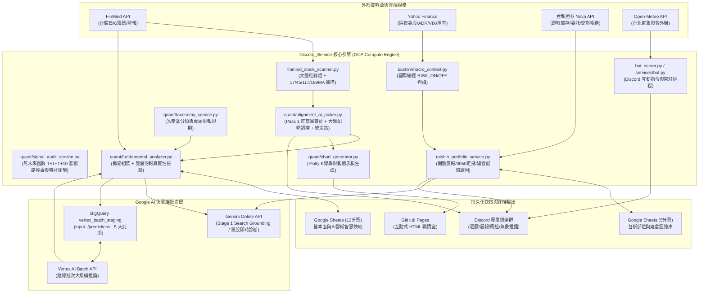
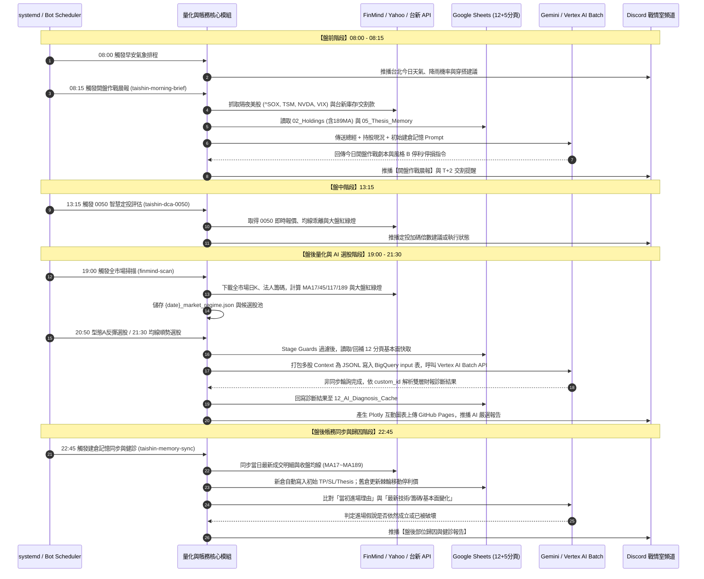
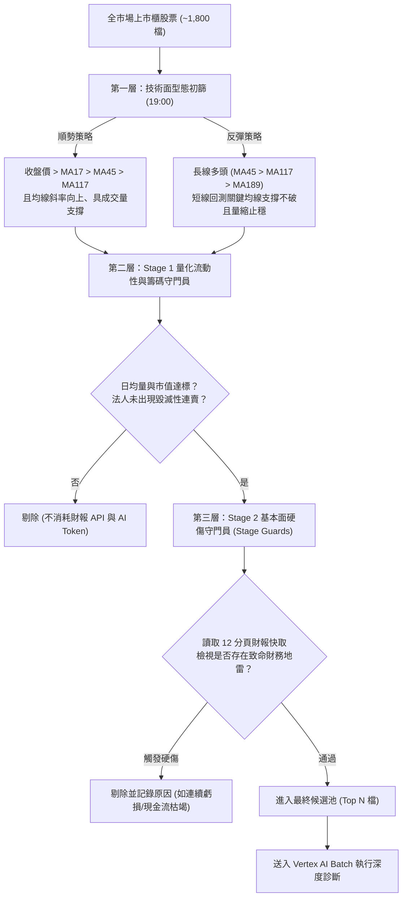

# Discord_Service 系統分析與設計規格書 (SASD)

* **專案名稱**：Discord_Service — 台股量化分析、AI 雙層診斷與台新證券智慧作戰系統
* **版本**：v5.7.0 (Single Source of Truth)
* **最後更新日期**：2026-11-09
* **運行環境**：Google Cloud Platform (GCP Compute Engine) + Linux `systemd` + Python 3.11 (`uv`)

---

## 目錄 (Table of Contents)

1. [第一章：需求分析 (Requirements Analysis)](#第一章需求分析-requirements-analysis)
   * 1.1 專案背景與核心痛點
   * 1.2 功能性需求 (Functional Requirements)
   * 1.3 非功能性需求 (Non-Functional Requirements)
2. [第二章：系統解決方案與整體架構 (System Architecture & Solutions)](#第二章系統解決方案與整體架構-system-architecture--solutions)
   * 2.1 痛點與技術解決方案對照表
   * 2.2 系統高階模組架構圖
   * 2.3 雲端與本地資料儲存設計 (12+5 分頁架構)
   * 2.4 全日自動化排程與時序圖
3. [第三章：核心業務流程設計 (Core Business Workflows)](#第三章核心業務流程設計-core-business-workflows)
   * 3.1 盤後量化掃描與兩階段 Pre-filter 漏斗流程
   * 3.2 Vertex AI Batch 離線批次與雙層基本面診斷流程
   * 3.3 建倉記憶錨定與「風格 B」棘輪移動停利流程
4. [第四章：AI 賦能盤點與 Prompt 資訊供給規格 (AI Context Inventory)](#第四章ai-賦能盤點與-prompt-資訊供給規格-ai-context-inventory)
   * 4.1 任務一：Stage 1 外部法說指引與輿情事實查核
   * 4.2 任務二：Stage 2 個股深度基本面與技術面綜合診斷
   * 4.3 任務三：08:15 開盤作戰晨報 AI 劇本生成
   * 4.4 任務四：22:45 建倉記憶歸因與盤後持股健診
   * 4.5 ★ AI 資訊供給充足度評估與未來擴充建議表
5. [第五章：系統效益分析 (Benefits Analysis)](#第五章系統效益分析-benefits-analysis)
   * 5.1 API 與 AI 運算成本效益
   * 5.2 交易紀律與風險控制效益
   * 5.3 投研時間與系統維運效益
6. [第六章：架構決策與版本演進紀錄 (ADR & Release History)](#第六章架構決策與版本演進紀錄-adr--release-history)

---

## 第一章：需求分析 (Requirements Analysis)

### 1.1 專案背景與核心痛點

個人投資者在台股波段操作與資產管理中，普遍面臨以下五大結構性痛點：

1. **資訊高度碎片化與時間成本過高**：每日盤後需跨越技術線圖、三大法人籌碼、月營收、季財報（損益表、資產負債表、現金流量表）以及隔夜美股總經數據進行交叉比對，人工檢視超過 1,800 檔上市櫃股票耗時且易有盲點。
2. **公司法說指引與實際財報落差（吹噓陷阱）**：許多題材股對外釋出樂觀指引，但實際財報卻出現「自由現金流為負」、「應收帳款與存貨週轉天數暴增」或「毛利率未如期提升」等警訊，單靠技術面極易買在主力出貨高點。
3. **進場後的主觀情緒干擾與「交易失憶症」**：買進時設定好停損與停利計畫，但盤中受價格波動影響而出現「賺一點就跑」或「跌破支撐卻凹單成長期股東」，忘記當初買進的核心假說（Thesis）。
4. **長短天期趨勢保護不足**：僅看短中期均線（如 17MA、45MA、117MA）容易在大型景氣循環轉折或長線走空時誤判支撐，缺乏長天期年線級別（189MA）的多空分水嶺保護。
5. **AI 即時推論成本高昂與連線逾時風險**：盤後對數十檔候選標的同時發起 LLM 即時請求（Online API），容易觸發 Rate Limit（429 錯誤）、等待時間過長，且 Token 費用居高不下。

---

### 1.2 功能性需求 (Functional Requirements)

| 需求編號 | 模組領域 | 需求描述 |
| :--- | :--- | :--- |
| **FR-01** | **大盤環境判讀** | 每日自動計算加權指數（TAIEX）之 17MA、45MA、117MA、189MA、騰落指標與外資期貨未平倉，判定大盤紅綠燈狀態（`GREEN` / `YELLOW` / `RED`）。 |
| **FR-02** | **量化雙策略選股** | 支援「均線多頭順勢排列（Alignment）」與「型態 A 跌深支撐反彈（Rebound）」兩種量化策略，並針對產業特性與流動性進行前置過濾（Pre-filter）。 |
| **FR-03** | **雙層 AI 財報診斷** | 結合產業分類規則（Sub-sector Taxonomy）與 Google Sheets 12 分頁財報快取，對候選股執行「真實性檢驗（Reality Check）」，並支援單筆即時與 Vertex AI Batch 離線批次雙模式。 |
| **FR-04** | **互動式圖表戰情室** | 自動產出包含 K 線、四條核心均線（17/45/117/189MA）、成交量、法人買賣超與財報儀表板的 Plotly 互動網頁，並自動發布至 GitHub Pages。 |
| **FR-05** | **台新證券帳務與交割連動** | 串接台新證券 Nova API，同步庫存成本、歷史已實現損益、計算 $T+2$ 交割款需求，並提供 0050 智慧不定期定額評估。 |
| **FR-06** | **建倉記憶與紀律風控** | 自動記錄每筆買進部位的「初始目標價（TP1/TP2）、初始停損價（SL）與進場理由」，每日 08:15 結合隔夜美股生成開盤作戰晨報，並於 22:45 執行盤後歸因健診。 |

---

### 1.3 非功能性需求 (Non-Functional Requirements)

* **NFR-01 成本最佳化**：盤後批次選股必須支援 GCP Vertex AI Batch API（享標準定價 50% 折扣），並透過本地與雲端多級快取減少重複呼叫。
* **NFR-02 容錯與高可用性**：當外部 API（FinMind、Google Sheets、Vertex AI、台新 API）發生瞬斷時，需具備指數退避重試（Exponential Backoff）與降級（Fallback）機制。
* **NFR-03 結構化輸出保證**：所有 AI 診斷結果必須通過嚴格的 JSON Schema 驗證與正規表達式修復，確保後續數值計算與表單寫入不中斷。
* **NFR-04 可觀測性與稽核**：所有 AI 請求與回應（含 Prompt 長度、Token 消耗、模型名稱、耗時）必須完整寫入 `logs/YYYY-MM-DD_ai_calls.log`。

---

## 第二章：系統解決方案與整體架構 (System Architecture & Solutions)

### 2.1 痛點與技術解決方案對照表

| 核心痛點 | 系統設計解決方案 | 對應核心模組 |
| :--- | :--- | :--- |
| **資料抓取緩慢與配額限制** | 建立 **Google Sheets 12 分頁智慧快取架構**，區分季報、月營收與日籌碼之 TTL（存活時間），搭配本地 JSON 快取。 | `quant/fundamental_cache.py` |
| **產業標準不一（拿電子股標準審金融/營建）** | 建立 **Sub-sector Taxonomy 產業專屬評估引擎**，針對半導體、AI 伺服器、航運、金融、生技、營建等定義專屬關鍵指標與地雷條件。 | `quant/taxonomy_service.py`<br>`quant/fundamental_config.py` |
| **無效標的浪費 AI Token** | 設計 **兩階段量化守門員（Stage Guards）**，先剔除日均量不足、淨值比異常或財務硬傷標的，僅放行高勝率候選股進入 AI 診斷。 | `finmind_stock_scanner.py`<br>`quant/alignment_ai_picker.py` |
| **批次選股 API 逾時與高成本** | 將診斷流程拆解為 `prepare_diagnosis_context()` 與 `finalize_diagnosis_from_ai()`，導入 **Vertex AI Batch API + BigQuery（input_/predictions_ 暫存表）** 離線非同步推論。 | `services/ai_service.py`<br>`quant/fundamental_analyzer.py` |
| **散戶凹單與停利過早** | 設計 **05_Position_Thesis_Memory 建倉記憶庫**，強制錨定初始 TP/SL，並實作 **風格 B（觸及 TP1 賣一半 + 單向棘輪移動停利）**。 | `taishin_portfolio_service.py`<br>`taishin/taishin_config.py` |
| **缺乏長線保護與國際視野** | 全面納入 **189MA（長線多空線）** 監控，並於盤前自動抓取費半、TSM ADR、NVDA、VIX、匯率計算 **Macro Regime**。 | `taishin/macro_context.py`<br>`finmind_stock_scanner.py` |

---

### 2.2 系統高階模組架構圖



---

### 2.3 雲端與本地資料儲存設計 (12+5 分頁架構)

系統採用雙 Google Spreadsheets 作為輕量級雲端關聯式資料庫與視覺化後台，結構如下：

#### A. 基本面智慧快取表 (`Fundamental_Cache`，共 12 分頁)
1. `01_Income_Statement`：季度綜合損益表（營收、毛利率、營益率、淨利率、EPS）。
2. `02_Balance_Sheet`：季度資產負債表（現金、應收帳款、存貨、合約負債、總負債、股東權益）。
3. `03_Cash_Flow`：季度現金流量表（營業現金流 OCF、資本支出 CapEx、自由現金流 FCF）。
4. `04_Monthly_Revenue`：月營收明細（單月營收、MoM、YoY、累計 YoY）。
5. `05_Valuation_PER_PBR`：每日估值指標（本益比 PER、股價淨值比 PBR、殖利率）。
6. `06_Dividend_History`：歷年股利政策與配息穩定度。
7. `07_Chip_Summary`：三大法人籌碼與個股融資融券維持率快取表（v5.5.0 擴充：`margin_balance_lots`、`margin_utilization_pct`、`margin_chg_5d_lots`、`margin_chg_20d_lots`、`short_margin_ratio_pct`、`est_margin_maint_pct` 估算融資維持率、`chip_quadrant_tag` 資法人對作四象限標籤）。
8. `08_Stock_Taxonomy`：細分次產業分類知識庫與同業標籤快取。
9. `09_Shareholding_Dispersion`：大戶與散戶集保股權分散表。
10. `10_SubSector_Taxonomy`：個股次產業分類映射與產業特性標籤。
11. `11_Guidance_Claims`：AI 萃取之公司法說會指引、產能擴充與新產品時程宣稱。
12. `12_AI_Diagnosis_Cache`：AI 最終診斷評分、Verdict、亮點、風險與目標價快取（避免同日重複消耗 Token）。

#### B. 台新個人投資作戰中心 (`Taishin_Portfolio`，共 5 分頁)
1. `01_Account_Statement`：全歷史買賣交易對帳單與成交總表。
2. `02_Portfolio_Holdings`：即時庫存明細，包含成本均價、市價、損益率，以及技術面四均線 **`ma17`、`ma45`、`ma117`、`ma189`**。
3. `03_Settlement_And_PnL`：歷史交割與已實現損益紀錄（不含銀行餘額與交割餘額預警）。
4. `04_DCA_0050_Tracker`：0050 每週不定期定額智慧尋底追蹤表。
5. `05_Position_Thesis_Memory`：**AI 建倉記憶核心表**，鎖定 `initial_tp1`、`initial_tp2`、`initial_sl`、`trailing_stop` 與 `entry_thesis`。

---

### 2.4 全日自動化排程與時序圖 (Single Source of Truth)

> 📌 **開發鐵則**：以下排程時間僅由作業系統層級之 `systemd` timers 控制，**嚴禁在 Python 業務邏輯、函式預設參數、Prompt 模板或 Discord 訊息標題中寫死時間字串**。所有報表標題與程式碼邏輯一律改為「功能導向描述」。

| 排程時間 (CST) | Systemd Timer / Service | 執行入口與核心職責 | 標準化 Discord 報表標題（無時間前綴） |
| :--- | :--- | :--- | :--- |
| **08:00** | `discordbot.service` | 台北早安氣象推播 (`weather_service.py`) | `🌤️ **台北今日天氣**` |
| **08:15** | `taishin-morning-brief.timer` | 盤前隔夜美股與波段持股開盤作戰指令 (`taishin_portfolio_service.py morning-brief`) | `☀️ 【台新證券 盤前開盤作戰晨報】` |
| **13:15** | `taishin-dca-0050.timer` | 0050 每週智慧尋底定投評估 (`taishin_portfolio_service.py eval-dca-0050`) | `📈 【0050 每週智慧尋底定投評估】` |
| **19:00** | `finmind-scan.timer` | 全市場日K、均線、大盤紅綠燈與融資水位掃描 (`finmind_stock_scanner.py`) | `📊 【台股盤後量化掃描快報】` |
| **20:50** | `finmind-rebound-ai.timer` | 型態 A 急跌回踩長均線反彈選股 (`alignment_ai_picker.py` rebound mode) | `🎯 【型態 A 反彈 AI 嚴選決策報告】` |
| **21:30** | `finmind-ai-pick.timer` | 均線多頭順勢選股與 Stage 2 跨股總決策 (`alignment_ai_picker.py` trend mode) | `🎯 【AI 嚴選進場決策報告】` |
| **22:45** | `taishin-memory-sync.timer` | 盤後對帳單同步與建倉記憶歸因 (`taishin_portfolio_service.py sync-memory`) | `🌙 【台新 盤後持股記憶歸因快訊】` |



---

## 第三章：核心業務流程設計 (Core Business Workflows)

### 3.1 盤後量化掃描與兩階段 Pre-filter 漏斗流程

為了避免將全市場 1,800 檔股票直接送入 AI 造成巨額費用與雜訊，系統設計了嚴格的漏斗篩選機制：



---

### 3.2 Vertex AI Batch 離線批次與雙層基本面診斷流程 (v5.3.0 核心)

在 `quant/fundamental_analyzer.py` 與 `services/ai_service.py` 中，單筆即時模式（Discord `/stock_ai` 指令）與排程批次模式（20:50 / 21:30）共用相同的商業邏輯，透過「前後端解耦」實現：

1. **脈絡準備階段 (`prepare_diagnosis_context`)**：
   * 確認個股次產業分類（`SubSectorRules`），載入該產業專屬的觀察指標與免責項（例如：金融業不看毛利率與自由現金流；營建業重看合約負債與完工入帳週期）。
   * 若需要更新法說會指引（Stage 1），先透過具備 Google Search Grounding 的輕量模型萃取最新法說展望並快取至 `11_Guidance_Claims`。
   * 組裝完整的基本面、籌碼面與技術面數據，生成標準化的 Stage 2 Prompt 與唯一識別碼 `custom_id`（格式如 `diag_{date}_{stock_id}`）。
2. **批次提交與輪詢階段 (`run_vertex_batch_requests`)**：
   * **端點分流設計**：AI 模型推論端點（Vertex AI API / Batch）一律固定使用 `VERTEX_LOCATION="global"`（避免 `gemini-4-argon`、`gemini-3.8-flash` 等新世代模型在區域端點發生 `404 NOT_FOUND`）；BigQuery 暫存與永久表則存放在 `BQ_LOCATION="us-central1"`。
   * 將所有候選股的請求寫入專屬 BigQuery 輸入表（`bq://{project}.vertex_batch_staging.input_{seq}`，5 天自動到期）。
   * 呼叫 Vertex AI Batch Prediction Job 提交任務，系統以非同步輪詢（Polling）監控任務狀態，完成後讀取 BigQuery `predictions_{seq}` 輸出表，並以免費 Batch Load 歸檔至 `discord_service.ai_prompt_logs`。
3. **結果回填與快取階段 (`finalize_diagnosis_from_ai`)**：
   * 依據 `custom_id` 將 AI 回傳的 JSON 解析並套用產業專屬分數微調與風控降級規則（例如：若公司宣稱樂觀但數據背離，強制將 Verdict 標記為「吹噓」或「待驗證」）。
   * 寫入 `12_AI_Diagnosis_Cache` 與本地 `YYYY-MM-DD_ai_calls.log`。

---

### 3.3 建倉記憶錨定與「風格 B」棘輪移動停利流程

系統透過 `05_Position_Thesis_Memory` 解決散戶「忘記初衷」與「抱上抱下」的問題：

* **初始建倉錨定**：當 `taishin-memory-sync` 偵測到新買進庫存時，會自動調閱最近一次 AI 選股報告或即時觸發診斷，將買進當下的：
  * 初始第一目標價 $TP_1$
  * 初始第二目標價 $TP_2$
  * 初始防守停損價 $SL_{init}$
  * 進場核心理由（`entry_thesis`）
  寫入記憶庫並鎖定（不可隨每日股價波動而任意下修停損）。
* **風格 B（分批鎖利 + 單向棘輪防守）運算邏輯**：
  * **階段一（未達 $TP_1$）**：防守線為 $\max(SL_{init}, \text{關鍵防守均線})$。若收盤跌破 $SL_{init}$，觸發無條件停損警報。
  * **階段二（觸及或突破 $TP_1$）**：
    1. 系統將 `tp1_hit_flag` 設為 `True`，於 08:15 晨報強制提示：**「執行風格 B：建議先調節 50% 部位（可掛盤中零股）鎖定獲利」**。
    2. 剩餘 50% 部位啟動 **單向棘輪移動停利（Ratchet Trailing Stop）**，新防守價計算公式為：
       $$SL_{new} = \max\left(SL_{prev}, \text{Cost}_{avg}, MA_{17}, MA_{45}\right)$$
       防守價**只升不降**（$SL_t \ge SL_{t-1}$），確保波段獲利不會回吐變成虧損，並一路追蹤至 $TP_2$ 或跌破移動停利線為止。

### 3.4 Pass 1 紅藍軍審計與庫存曝險耦合流程 (v5.6.0)

```
[finmind_stock_scanner.py]  compute_deterministic_trade_setup()  → ATR14 / 60 日量 POC / 追價上限 / 硬停損 / TP1 / R:R
                            align_news_with_price_action()       → 新聞發布日量價反應標籤
[taishin_portfolio_service.py] evaluate_candidate_exposure()     → OPEN / HIGH_CORR_WARNING / SECTOR_OR_CORR_FULL_SWAP_ONLY
[quant/alignment_ai_picker.py] run_audit_stage()
   ├─ Pass 1：run_red_blue_audit()（每 3 檔一批、asyncio.gather）→ StockAuditItem（bear_case_flaws 先、verdict_grade 後）
   ├─ _enforce_post_audit_guards()：風報比 < 1.8 的 S 級降級／淘汰；庫存滿載強制 PORTFOLIO_SWAP_ONLY
   └─ select_audit_survivors()：剔除 REJECT_TRAP / NO_TRADE（允許 0 檔，Zero-Pick Veto）
   → Pass 2：Stage 2 跨股總決策（沿用 Python 點位，TP1 / 停損不得改寫）
```

* **資料結構**：`DeterministicTradeSetup`（dict，欄位見 `compute_deterministic_trade_setup`）、`PortfolioExposureCheckResult`、`StockAuditItem` / `BatchAuditResponse`（Pydantic）。
* **曝險規則**：同細分產業（`taxonomy_service`）持股 ≥ 2 檔或權重 > 35%，或 60 日日報酬皮爾森相關係數 ≥ 0.80 → 僅限換股；0.70 ≤ corr < 0.80 → 高度共伴警示。重疊交易日 < 30 則不計相關係數。
* **輸出**：`top_picks[*].audit`（`Audit_Grade`、`Execution_Tactic`、`Ideal_Buy_Or_Ref`、`Chase_Limit_Price`、`Hard_Stop_Loss`、`TP1_Target_Or_POC`、`Deterministic_RR`、`Bear_Case_Warning`、`Invalidation_Triggers`）寫入 `ai_recommendations.json` 並顯示於 Discord；`05_Position_Thesis_Memory` 工作表欄位尚未擴充（後續階段）。
* **降級策略**：審計流程任一環節失敗皆退回未審計流程，不中斷排程。

---

## 第四章：AI 賦能盤點與 Prompt 資訊供給規格 (AI Context Inventory)

本章節完整盤點系統在 4 大 AI 任務中**實際餵給模型的每一項數據欄位**，作為您評估「AI 獲得的資訊是否充足、是否需要增減欄位」的基準規格。

---

### 4.1 任務一：Stage 1 外部法說指引與輿情事實查核

* **觸發時機**：個股首次進入診斷池，或 `11_Guidance_Claims` 快取已過期時。
* **使用模型與工具**：Gemini Flash 模型 + **Google Search Grounding（聯網搜尋）**。
* **餵給 AI 的資訊 (Inputs)**：
  * 股票代號 (`stock_id`)、股票名稱 (`stock_name`)、所屬次產業名稱 (`sub_sector`)。
  * 查詢時間錨點（當前年份與季度，要求鎖定近 3~6 個月內之最新資訊）。
* **要求 AI 萃取的資訊 (Expected Outputs)**：
  1. 管理層最新法說會或公開營收展望（如：預期下半年毛利率走勢、稼動率、訂單能見度）。
  2. 具體的成長動能宣稱（如：AI 伺服器營收佔比目標、新廠投產時程、大客戶認證進度）。
  3. 潛在外部利空或產業逆風（如：匯損影響、報價下跌、庫存調整）。

---

### 4.2 任務二：Stage 2 個股深度基本面與技術面綜合診斷

* **觸發時機**：20:50 反彈選股、21:30 順勢選股（透過 Vertex AI Batch API），以及 Discord `/stock_ai` 單股查詢。
* **餵給 AI 的完整資料清單 (Context Payload)**：

| 資訊維度 | 餵入 AI Prompt 的具體數據欄位與計算邏輯 | 資料時間跨度 |
| :--- | :--- | :--- |
| **1. 產業規則與背景** | • 次產業分類名稱 (`sub_sector`)<br/>• 產業專屬審核重點提示 (`industry_prompt_hint`)<br/>• 產業豁免指標清單（例如特定產業不懲罰負 FCF 或高負債） | 靜態規則庫 + 動態映射 |
| **2. 外部宣稱 (Stage 1)** | • Stage 1 萃取之公司法說會指引摘要 (`guidance_claims`) | 近 1~2 季公開資訊 |
| **3. 獲利能力 (損益表)** | • 毛利率 (`Gross Margin %`) 與季增減 (QoQ)、年增減 (YoY) 趨勢<br/>• 營業利益率 (`Operating Margin %`) 與三率三升/三降狀態<br/>• 近四季累積每股盈餘 ($EPS_{TTM}$) 與單季 EPS 變化<br/>• 股東權益報酬率 ($ROE$) | 近 4~8 季趨勢 |
| **4. 營收動能 (月營收)** | • 最新單月營收金額<br/>• 月增率 ($\text{MoM } \%$)、年增率 ($\text{YoY } \%$)、累計年增率 ($\text{Cumulative YoY } \%$)<br/>• 營收是否創近 N 個月新高或連續成長月數 | 近 6~12 個月 |
| **5. 領先指標與營運效率** | • **合約負債 (`Contract Liabilities`)**：金額與季變化率（預收貨款/在手訂單領先指標）<br/>• **資本支出 (`CapEx`)**：金額與擴產趨勢<br/>• **現金轉換週期 ($CCC$)**：$$\text{CCC} = \text{DSO (應收天數)} + \text{DIO (存貨天數)} - \text{DPO (應付天數)}$$ 檢視存貨堆積或收款惡化 | 近 4 季比較 |
| **6. 現金流品質** | • 營業活動現金流 ($OCF$) 與自由現金流 ($$\text{FCF} = \text{OCF} - \text{CapEx}$$)<br/>• **盈餘品質比率**：$$\frac{\text{OCF}}{\text{Net Income}}$$（檢視帳面獲利是否真正收回現金） | 近 4 季 |
| **7. 償債與財務結構** | • 淨負債比率 (`Net Debt to Equity`)、速動比率 (`Quick Ratio`)、利息保障倍數 | 最新一季 |
| **8. 估值與股利保護** | • 本益比 ($PER$)、股價淨值比 ($PBR$)、現金殖利率 (`Dividend Yield %`)、歷年配息穩定度 | 最新日資料 + 近 3~5 年配息 |
| **9. 籌碼面結構** | • 外資近 5 日 / 20 日累計買賣超張數與持股比例變化<br/>• 投信近 5 日 / 20 日累計買賣超張數與連買天數<br/>• 融資使用率變化與大戶持股比例趨勢 | 近 5 日 / 20 日 |
| **10. 技術面與大盤位階** | • 收盤價、漲跌幅、成交量與量能倍數<br/>• **四條核心均線**：$$\text{MA}_{17}, \text{MA}_{45}, \text{MA}_{117}, \text{MA}_{189}$$ 數值與排列關係<br/>• 技術指標：RSI、MACD 柱狀體、KD、ATR 波動度<br/>• 當前大盤紅綠燈狀態 (`market_regime`) | 最新交易日 |

* **要求 AI 產出的結構化 JSON 欄位**：
  * `verdict`：僅限 `"符合"`、`"待驗證"`、`"吹噓"` 三選一（檢驗財報數據是否支撐法說指引）。
  * `score`：$0 \sim 100$ 整數評分。
  * `highlights`：3 點具體量化優勢。
  * `risks`：明確的財務、籌碼或技術面風險。
  * `guidance`、`fcf_and_roe`、`chip_and_dividend`：分項深度短評。
  * `entry_thesis`、建議進場區間、初始停利 ($TP_1, TP_2$) 與初始停損 ($SL$)。

---

### 4.3 任務三：08:15 開盤作戰晨報 AI 劇本生成

* **觸發時機**：每週一至週五 08:15 (`taishin-morning-brief`)。
* **餵給 AI 的完整資料清單 (Context Payload)**：
  1. **隔夜國際總經數據 (`macro_context.py`)**：
     * 費城半導體指數 (`^SOX`)、那斯達克 (`^IXIC`)、標普 500 (`^GSPC`) 漲跌幅。
     * 台積電 ADR (`TSM`)、輝達 (`NVDA`) 漲跌幅。
     * 恐慌指數 (`^VIX`) 水位與變化、美元兌台幣匯率 (`TWD=X`)。
     * 系統量化判定之總經環境標籤：`RISK_ON`（積極偏多）、`NEUTRAL`（震盪分歧）、`RISK_OFF`（避險防守）。
  2. **台股大盤紅綠燈快取**：
     * 加權指數收盤價與 $\text{MA}_{17}, \text{MA}_{45}, \text{MA}_{117}, \text{MA}_{189}$ 相對位階。
  3. **帳戶資金與交割狀態**：
     * 今日與明日 ($T+1, T+2$) 應收付交割款淨額、帳戶可用現金水位。
  4. **個別持股部位與建倉記憶對照**：
     * 每檔庫存股之：代號、名稱、持有股數、成本均價、最新市價、未實現損益金額與百分比。
     * 技術支撐位：該股最新 $\text{MA}_{17}, \text{MA}_{45}, \text{MA}_{117}, \text{MA}_{189}$。
     * 記憶庫錨定值：`initial_tp1`、`initial_tp2`、`initial_sl`、目前移動停利價 `trailing_stop`、`tp1_hit_flag`、當初買進理由 `entry_thesis`。
* **要求 AI 產出的內容**：
  * 今日台股開盤跳空方向預判與資金控管總綱。
  * 逐檔持股之今日盤中具體操作指令（明確指出哪一檔應掛單減碼 50% 零股、哪一檔跌破 189MA/45MA 需嚴格出場、哪一檔續抱移動停利）。

---

### 4.4 任務四：22:45 建倉記憶歸因與盤後持股健診

* **觸發時機**：每週一至週五 22:45 (`taishin-memory-sync`)。
* **餵給 AI 的完整資料清單 (Context Payload)**：
  * 持股當初建倉鎖定的 `entry_thesis`（例如：「看好 Q3 毛利率跳升與投信連買突破 45MA」）。
  * 今日最新收盤價與 $\text{MA}_{17}, \text{MA}_{45}, \text{MA}_{117}, \text{MA}_{189}$ 跌破/站穩狀態。
  * 最新三大法人買賣超變化、最新月營收與財報快取摘要。
* **要求 AI 產出的內容**：
  * **Thesis 存續性判定**：「進場理由強化」、「理由維持不變」或「進場理由已遭破壞（Thesis Broken）」。
  * 若進場理由已遭破壞（即使尚未觸及價格停損 $SL$），提前發出主觀歸因預警，防止基本面或籌碼面轉空卻死守技術停損位。

---

### 4.5 ★ AI 資訊供給充足度評估與未來擴充建議表

為了協助您評估「目前餵給 AI 的資訊是否足夠」，以下針對各維度進行診斷：

| 評估維度 | 目前供給給 AI 的資訊量 | 充足度評級 | 潛在盲點分析與未來可擴充之高價值資訊 |
| :--- | :--- | :---: | :--- |
| **基本面三表與現金流** | 涵蓋毛利/營益率、EPS、ROE、合約負債、CCC、OCF/NI、FCF、淨負債比、月營收 YoY/MoM。 | **⭐⭐⭐⭐⭐<br/>(極度充足)** | 目前財務比率已達機構法人級別。唯一可再微調的是加入 **「同次產業橫向百分位數（Peer Percentile）」**（例如告知 AI 該股毛利率在同業排名前 20%），可減少 AI 對單一數值高低的誤判。 |
| **技術面趨勢與支撐** | 涵蓋收盤價、量能倍數、17/45/117/189MA、RSI、MACD、KD、ATR。 | **⭐⭐⭐⭐⭐<br/>(v5.3.0 補齊)** | v5.3.0 補齊 `189MA` 後，長短天期均線骨架已非常完整。未來若要強化突破真偽判斷，可多餵入 **「近 60 日大量成交密集區價位（Volume Profile POC）」** 或 **「前波高點套牢區價位」**。 |
| **籌碼面結構** | 涵蓋外資/投信 5D & 20D 買賣超、持股比例、融資變化、集保股權分散。 | **⭐⭐⭐⭐☆<br/>(充足)** | 對中大型股極為準確。但針對中小型題材股，未來若能補充 **「有無發行可轉債（CB）未轉換餘額」** 或 **「借券賣出餘額變化」**，AI 對主力假突破或避險套利的識破率會更高。 |
| **法說指引與新聞輿情** | 依賴 Stage 1 Gemini Search Grounding 搜尋近 3~6 個月公開新聞摘要。 | **⭐⭐⭐☆☆<br/>(中等，具提升空間)** | 公開新聞搜尋偶爾會有農場文雜訊或遺漏法說會細節。若未來能串接 **公開資訊觀測站（MOPS）法說會簡報摘要** 或 **近 30 日券商研究報告共識目標價（Consensus EPS）**，Reality Check 的銳利度會再升一級。 |
| **盤前晨報與帳務風控** | 涵蓋美股四大指數/TSM/NVDA/VIX/匯率、T+2交割、庫存均價、17~189MA、初始 TP/SL/Thesis。 | **⭐⭐⭐⭐⭐<br/>(極度充足)** | 資訊閉環非常完整。唯一可小幅擴充的是加入 **「單一持股佔總資產權重百分比（Position Sizing %）」** 與 **「同產業集中度」**，讓 AI 在晨報中能針對重倉股給予更嚴格的減碼建議。 |

---

## 第五章：系統效益分析 (Benefits Analysis)

### 5.1 API 與 AI 運算成本效益

1. **Vertex AI Batch API 節省 50% 推論費用**：
   * 每日 20:50 與 21:30 選股排程改由 BigQuery + Vertex AI Batch 執行，相較於即時 Online API，直接降低 $50\%$ 的 Token 計費成本，且完全消除盤後大量併發請求造成的 `429 Resource Exhausted` 錯誤。
2. **兩階段 Pre-filter 與 12 分頁快取攔截 75% 以上無效消耗**：
   * 全市場約 1,800 檔股票經技術面初篩與 `StageGuards` 基本面硬傷過濾後，每日僅約 $10 \sim 25$ 檔高價值標的進入 AI 深度診斷；加上季報與月營收採用 Google Sheets 分頁快取，FinMind API 每日呼叫次數控制在安全配額內。

### 5.2 交易紀律與風險控制效益

1. **消除「交易失憶症」與凹單行為**：
   * 透過 `05_Position_Thesis_Memory` 強制記錄買進當下的 $TP_1, TP_2, SL_{init}$ 與進場理由，每日 08:15 與 22:45 自動拿「當初的自己」對照「現在的盤勢」，杜絕盤中臨時改口凹單。
2. **「風格 B」機械化鎖利提高資金周轉率**：
   * 觸及 $TP_1$ 先調節 $50\%$ 部位落袋為安，剩餘部位以單向棘輪移動停利保護，兼顧「落袋現金流」與「捕捉大波段趨勢」的雙重優勢。
3. **189MA 長線多空防線**：
   * 在大盤紅綠燈與個股庫存全面納入 `189MA`，當大盤或個股跌破長線生命線時提供明確降檔警訊，避免在空頭初期過早接刀。

### 5.3 投研時間與系統維運效益

* **每日節省 2.5 小時人工研究時間**：原本需人工翻閱數十檔股票財報、計算三率與現金流、繪製均線圖與核對台新交割款的工作，全部壓縮為 Discord 頻道中可一鍵點開的 Plotly 互動圖表與精煉作戰摘要。
* **全自動無狀態恢復**：透過 `systemd` Timer 與 `bot_server.py` 6 小時心跳監控，即使 GCP VM 重啟或網路瞬斷，排程與快取皆能自動銜接。

---

## 第六章：架構決策與版本演進紀錄 (ADR & Release History)

> 💡 **文件治理說明**：本章節整合專案關鍵架構決策（Architecture Decision Records, ADR）與重大版本演進快照，可直接作為專案的歷史演進索引，取代傳統獨立且易瑣碎化的 `CHANGELOG.md`。

| 版本號 | 發布日期 | 核心架構決策與改版重點 (Key Changes & ADRs) | 影響模組 |
| :--- | :--- | :--- | :--- |
| **v5.7.0** | 2026-11-09 | 1. **Phase 3 台股微結構過濾與除權息補償**：強制 20 日成交金額中位數 $\ge 5,000$ 萬護欄（`passes_liquidity_median_guard`）、注意／處置過熱預警（`evaluate_disposition_risk`）與除權息前複權回溯補償（`compensate_ex_dividend_gaps`）。<br/>2. **三層籌碼微結構與同族群資金共振度**：停資券日曆窗口、週集保大戶底氣（`evaluate_weekly_tdcc_anchor`）、日融資 K 線實體效率四象限（`classify_daily_margin_efficiency`）與同細分產業站上 17MA 廣度（`compute_sector_breadth`）。<br/>3. **加權＋櫃買（OTC）雙核心路由（`RegimeRouter`）**：結合櫃買 MA20 斜率與外資台指期淨空單變化動態控管右側突破與 Style B 低接配額。<br/>4. **無未來函數事後審計閉環（`quant/signal_audit_service.py`）**：SQLite `data/signal_audit.db` 與 `09_Signal_Audit_Log` 同步，嚴守 `Open_{T+1} + 0.5%` 摩擦成本、停損優先悲觀認定與 `REJECT_TRAP` 錯殺率追蹤，週五自動推播 `Weekly Quantitative Audit Summary`。<br/>5. **Phase 1~3 全鏈路貫通**：Vertex Structured Output `response_schema`、`AI_Daily_Picks` 與 `05_Position_Thesis_Memory` 同步擴充 9 個確定性審計欄。 | `finmind_stock_scanner.py`<br>`finmind_scanner.json`<br>`taishin/macro_context.py`<br>`quant/taxonomy_service.py`<br>`quant/signal_audit_service.py`<br>`quant/alignment_ai_picker.py`<br>`quant/fundamental_analyzer.py`<br>`quant/fundamental_config.py`<br>`taishin/taishin_config.py`<br>`taishin_portfolio_service.py`<br>`services/ai_service.py` |
| **v5.6.0** | 2026-11-05 | 1. **Phase 1 AI 紅藍軍審計**：自回歸防偏誤 Schema、有罪推定 Prompt、Zero-Pick Veto。<br/>2. **算術歸 Python**：ATR / 量 POC / 追價上限 / 硬停損 / TP1 / 風報比確定性計算。<br/>3. **庫存曝險耦合**：同產業上限與 60 日報酬相關係數攔截。<br/>4. **新聞量價反應綁定**：辨識利多出貨。<br/>5. **Phase 2 無盲點基本面特徵工程與事件驅動快取**：三層防呆真實流通股數還原（`|EPS| >= 0.25`）、含農曆春節豁免之右側營收動能與 QTD Run-Rate、本業前瞻 EPS 與同產業中位數 PE 對齊、三率變動語意標籤（含殺價搶單警訊）與每月 5 日起營收開獎窗口 Event-Driven Cache Bypass（含 6 小時冷卻保護）。 | `quant/alignment_ai_picker.py`<br>`quant/fundamental_analyzer.py`<br>`quant/fundamental_config.py`<br>`quant/fundamental_cache.py`<br>`quant/taxonomy_service.py`<br>`finmind_stock_scanner.py`<br>`taishin_portfolio_service.py` |
| **v5.5.0** | 2026-11-04 | 1. **大盤與個股融資籌碼風控整合**：串接 TWSE/TPEx 官方免費 OpenAPI 取得大盤融資（`fetch_market_margin_snapshot`），升級 `evaluate_market_regime` 辨識「散戶凹單未洗清」與「融資斷頭宣洩」並動態給出建議總持倉上限 (`recommended_max_exposure_pct`)。<br/>2. **07_Chip_Summary 融資擴充**：串接 FinMind `TaiwanStockMarginPurchaseShortSale` 實作估算融資維持率 (`est_margin_maint_pct`) 與「資法人對作四象限標籤 (`chip_quadrant_tag`)」，賦能 Stage 0 硬性排雷與 Stage 1/2 Prompt。<br/>3. **全專案硬編碼時間字串徹底解耦**：移除所有程式碼、Docstring、Prompt 與報表標題之寫死排程時間，統一由本規格書第 2.4 節與 `systemd` 控制。<br/>4. **0050 DCA 恐慌殺融資加碼**：當大盤融資單日暴減 $\le -40$ 億或 5 日累計暴減 $\le -90$ 億時自動提高定投評分與加碼倍數。 | `finmind_stock_scanner.py`<br>`quant/fundamental_cache.py`<br>`quant/fundamental_config.py`<br>`quant/fundamental_analyzer.py`<br>`quant/alignment_ai_picker.py`<br>`services/ai_service.py`<br>`taishin_portfolio_service.py`<br>`taishin/taishin_config.py` |
| **v5.4.0** | 2026-11-04 | 1. **Vertex AI Batch 改用 BigQuery 交換媒介**：每批獨立 `input_{seq}` / `predictions_{seq}` 暫存表（`vertex_batch_staging`，5 天自動到期），移除 GCS 依賴。<br/>2. **AI 日誌集中化**：Batch 與 Online Gemini 呼叫皆以免費 `load_table_from_json` 寫入 `discord_service.ai_prompt_logs`（失敗只記 Warning，不中斷主流程）。 | `services/ai_service.py`<br>`quant/alignment_ai_picker.py`<br>`quant/fundamental_analyzer.py`<br>`taishin_portfolio_service.py`<br>`services/stock_ai_command.py` |
| **v5.3.0** | 2026-11-03 | 1. **導入 Vertex AI Batch API 離線批次架構**：將 20:50 反彈與 21:00 順勢選股改為打包 JSONL 上傳 GCS 非同步推論，並將 `fundamental_analyzer.py` 拆分為 `prepare_diagnosis_context()` 與 `finalize_diagnosis_from_ai()`。<br/>2. **全面整合 189MA 長天期均線**：大盤紅綠燈快取 (`evaluate_market_regime`) 與台新持股表 (`02_Portfolio_Holdings`)、AI 晨報/健診 Prompt 全面補齊 `MA189`。 | `services/ai_service.py`<br>`quant/fundamental_analyzer.py`<br>`quant/alignment_ai_picker.py`<br>`finmind_stock_scanner.py`<br>`taishin_portfolio_service.py` |
| **v5.2.x** | 2026-10 | 1. **台新開盤作戰晨報與建倉記憶庫上線**：新增 `05_Position_Thesis_Memory`，實作「風格 B（TP1 調節 50% + 單向棘輪移動停利）」。<br/>2. **整合隔夜美股總經 (`macro_context.py`)**：盤前自動抓取費半、TSM ADR、NVDA、VIX、匯率判定 `RISK_ON / NEUTRAL / RISK_OFF`。 | `taishin_portfolio_service.py`<br>`taishin/macro_context.py`<br>`taishin/taishin_config.py` |
| **v5.1.x** | 2026-09 | 1. **次產業專屬財報規則 (`SubSectorRules`) 與兩階段 Pre-filter (`StageGuards`)**：解決不同產業財報標準差異，並在呼叫 AI 前攔截流動性不足與財務硬傷股。<br/>2. **擴充型態 A 跌深反彈選股 (`finmind-rebound-ai.timer`)**。 | `quant/taxonomy_service.py`<br>`quant/fundamental_config.py`<br>`quant/alignment_ai_picker.py` |
| **v5.0.x** | 2026-08 | 1. **Google Sheets 12 分頁基本面智慧快取架構**：整合損益表、資產負債表、現金流量表（FCF、CCC、合約負債）與雙層 Gemini 真實性檢驗（Reality Check）。<br/>2. **台新證券 Nova API 帳務與 0050 智慧定投串接**。 | `quant/fundamental_cache.py`<br>`taishin/taishin_client.py` |
| **v4.x** | 2026-06 ~ 07 | 1. 建立 FinMind 台股技術面（17/45/117MA）與法人籌碼自動掃描。<br/>2. 實作 Plotly 互動式看盤戰情室並自動發布至 GitHub Pages。<br/>3. 完成 GCP Compute Engine `systemd` 服務常駐與 Open-Meteo 氣象推播。 | `finmind_stock_scanner.py`<br>`quant/chart_generator.py`<br>`services/github_uploader.py` |

## Phase 1 ~ Phase 3 完整閉環總覽（v5.7.0）
- **規格文件**：Phase 1 (`gemini-code-1793865428763.md`)、Phase 2 (`gemini-code-1793867722705.md`)、Phase 3 (`gemini-code-1794215693400.md`)。
- **端到端實盤資料流**：
  1. **19:00 盤後掃描 (`scan-all`)**：`RegimeRouter`（加權 + 櫃買 OTC + 外資台指期）產出 `regime_quota` → `finmind_stock_scanner.py` 執行 20 日成交金額中位數護欄（$\ge 5,000$ 萬）與除權息前複權補償 → 盤後自動觸發 `run_signal_audit_backfill()` 回填 `data/signal_audit.db` 之 T+1~T+10 實盤悲觀路徑並同步至 Google Sheets `09_Signal_Audit_Log`。
  2. **21:30 AI 嚴選 (`analyze-alignment`)**：Event-Driven Cache Bypass（每月 5 日起營收開獎窗口）→ Phase 2 無盲點基本面特徵（三層安全股數、春節豁免營收動能、本業前瞻 EPS × 橫斷面同業中位數 PE、三率語意標籤）→ Phase 3 微結構（除權息前複權 POC/ATR、處置過熱預警、停資券日曆＋週集保大戶底氣＋日融資 K 線效率、同細分產業 `SectorBreadth`）+ 台新庫存相關係數曝險 + 近 5 交易日新聞量價對齊 → Pass 1 紅藍軍審計（Vertex Structured Output `BatchAuditResponse`）→ Python 後置硬攔截與配額調控（`enforce_regime_quotas`）→ 全數留痕 `signal_audit.db`、寫入 `AI_Daily_Picks`（含 9 個確定性審計欄）並同步 `09_Signal_Audit_Log`（每週五盤後自動附加 `Weekly Quantitative Audit Summary` 推播）。
  3. **22:45 建倉記憶歸因 (`sync-memory`)**：自動由 `AI_Daily_Picks` 繼承 Python 確定性硬停損、TP1 與 9 個紅藍軍審計欄位寫入 `05_Position_Thesis_Memory`，銜接隔日 08:15 開盤作戰晨報。
